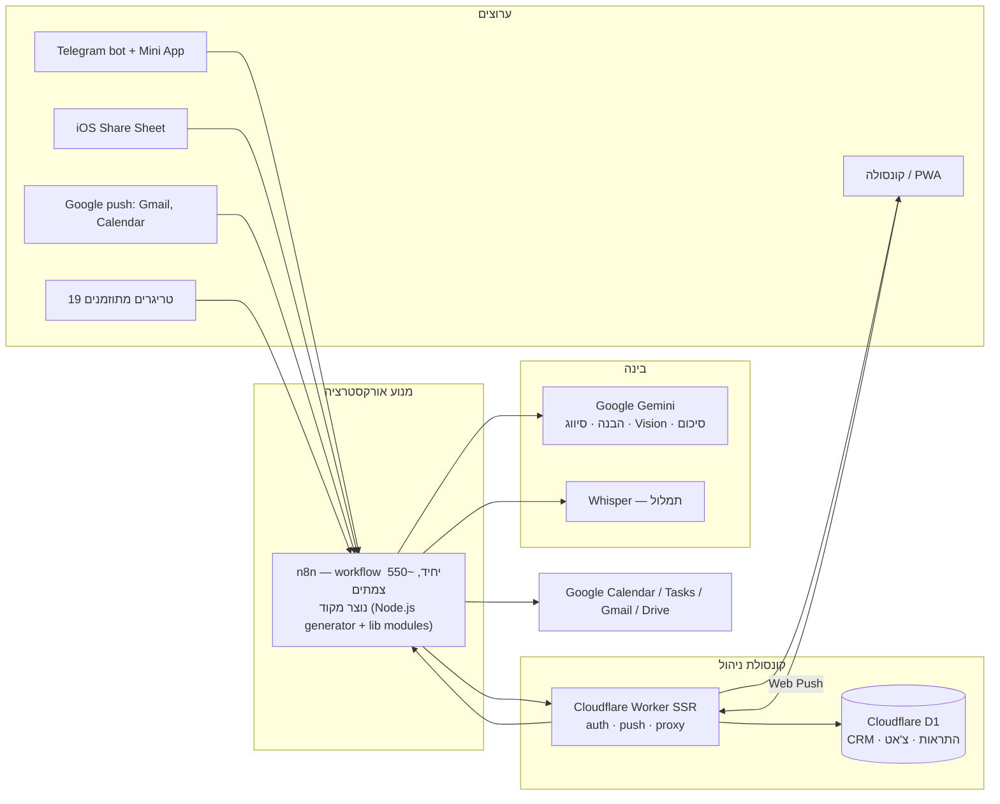
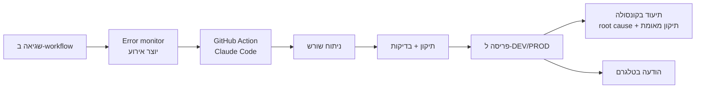

# Chief-of-Staff AI · סוכן אישי לניהול העסק

**🟢 בייצור · שימוש יומיומי מאז 2026**

סוכן AI שמנהל את "הצד האדמיניסטרטיבי" של עסק ייעוץ: פגישות, מיילים, יומן, משימות ולידים. עובד מתוך טלגרם (בוט + Mini App), Share Sheet באייפון וקונסולת ניהול ב-PWA.

<!-- MEDIA: סרטון 60–90 שניות: הודעה קולית בטלגרם → סיכום פגישה → משימות ביומן → ליד ב-CRM -->
<!--  -->

## הבעיה
עצמאית שעובדת עם הרבה לקוחות במקביל מבלה שעות על תיאום, סיכומי פגישות, מעקב לידים ומיילים. הכלים קיימים (Gmail, Calendar, Tasks), אבל אף אחד לא מחבר ביניהם ולא יוזם.

## מה הסוכן עושה
- **סיכום פגישות:** מקליט/מתמלל, מסכם, מחלץ משימות והחלטות ומציע אותן לאישור.
- **CRM מובנה:** לידים, פעולות ומעקבים, כולל סנכרון אוטומטי מהמייל.
- **יומן חכם:** זיהוי כפילויות, שיוך אירועים ל"מרחב עבודה" (לקוח/פרויקט), "שומר אג'נדה" שמתריע על עומס.
- **יוזמה (Proactive):** 19 שרשראות מתוזמנות — איזון שבועי בין סוגי עבודה, הצעות ליומן, התראות על לידים שלא טופלו, בדיקת בריאות חיבורים.
- **מיילים:** סינון רך והעברה חכמה, טיוטות תגובה.
- **קבלות והוצאות:** צילום קבלה → מסמך מסודר.
- **פעולות עם אישור:** כל פעולה שכותבת החוצה מוצגת עם כפתורים רלוונטיים להקשר בלבד ("לאשר / לערוך / לדחות").

## ארכיטקטורה

### תיקון תקלות עצמאי (Self-healing)

## טכנולוגיות
| שכבה | טכנולוגיה |
|---|---|
| אורקסטרציה | n8n (Docker), workflow שנבנה מקוד JS ולא ידנית בממשק |
| AI | Google Gemini (Flash / Flash-Lite), Whisper מקומי בקונטיינר |
| קונסולה | Cloudflare Workers + SSR, Cloudflare D1 (SQLite), Web Push |
| אינטגרציות | Telegram Bot API, Gmail, Google Calendar, Tasks, Drive |
| DevOps | GitHub Actions, Claude Code Action, סקריפט פריסה עם restart ואימות |

## Deployment
- **שתי סביבות נפרדות** (DEV / PROD), כל אחת עם דומיין, טוקנים ו-workflow משלה.
- n8n רץ ב-Docker Compose על שרת ענן מאחורי Cloudflare.
- הקונסולה היא Cloudflare Worker מוגן; **נכשל-סגור** אם הסודות חסרים. הדפדפן מקבל רק תמונות-מצב מנוקות — אף פעם לא טוקנים, תוכן מיילים או היסטוריית צ'אט.
- פריסה רק דרך סקריפט ייעודי (push → restart → אימות שהטריגרים חזרו לפעול).

## אתגרים ופתרונות (חומר לראיון)
- **"פריסה שקטה שהורגת טריגרים":** עדכון workflow דרך ה-API מדווח הצלחה אבל לא מפעיל מחדש טריגרים מתוזמנים. הפתרון: פריסה שתמיד כוללת restart ובדיקת זמן העלייה של הקונטיינר.
- **כשלים שקטים:** מיפוי מספרי של כל הצמתים שבולעים שגיאות, סיווג ידני, וניטור שגיאות שפותח אירוע.
- **Workflow של מאות צמתים כקוד:** גרסאות, code review ובדיקות במקום עריכה ידנית בממשק גרפי.
- **מודל איום ותיעוד מערכת:** inventory, data flow ו-threat model לפני כל שינוי מבני.

## מדיה להוסיף
- [ ] צילום מסך של הקונסולה (עלויות, פעילות, אירועים) — **עם נתונים מטושטשים**
- [ ] GIF של שיחה בטלגרם עם כפתורי אישור
- [ ] צילום של דף "אירוע ותיקון" (root cause + remediation)
