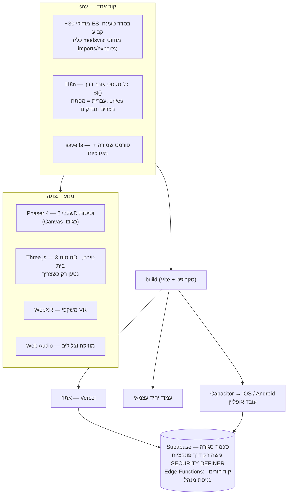
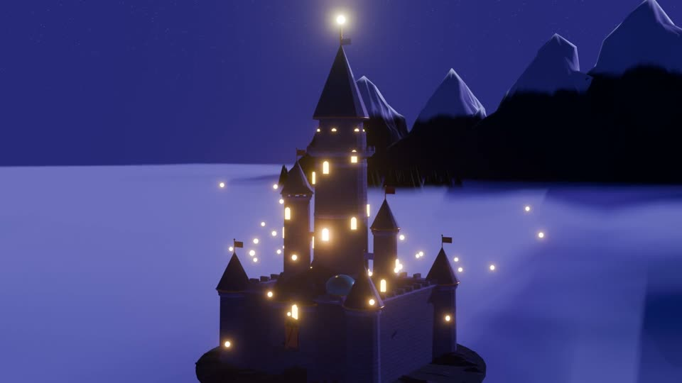

# מגדל הערפל · Tower of Mist

**🟢 חי באתר: [migdal-haarafel.vercel.app](https://migdal-haarafel.vercel.app) · 🟡 בדרך ל-App Store ו-Google Play**

> משחק הרפתקאות מקורי באקדמיה לקסמים, שנבנה בשביל ילד ויחד איתו — ועכשיו גם לילדים אחרים.

▶️ [סרטון הפתיחה המלא (36 שניות)](../assets/migdal-haarafel/intro.mp4)

| | |
|---|---|
| **קהל** | ילדים בגילאי 6–11 (קטגוריות Kids בחנויות: 6–8, 9–11) |
| **שפות** | עברית, אנגלית, ספרדית — כולל כיוון מימין לשמאל ומשמאל לימין |
| **פלטפורמות** | דפדפן (טלפון, טאבלט, מחשב), משקפי VR (WebXR), iOS ו-Android דרך Capacitor |
| **היקף** | 2 עונות · 82 שלבים · ~650 קומיטים · 218 בדיקות אוטומטיות |
| **זמן** | בפיתוח פעיל, עדכון לשחקנים בכל גרסה |

## הסיפור
המשחק התחיל כרעיון של ילד בן 9 שרצה "משחק קסמים משלו". הוא שותף לעיצוב, בודק כל גרסה בטלפון, והבאגים שלו מתוקנים ראשונים. העיקרון: **"designed by a kid, for kids"** — וזה גם הסיפור השיווקי החזק ביותר שלו.

## מה יש במשחק
**עולם ומשחקיות**
- **שתי עונות — 32 + 50 שלבים:** שלבי קרקע ב-2D, טיסות על מטאטא ב-2D וב-3D, וטיסה חופשית בשמיים פתוחים.
- **טירה תלת-ממדית** שמשמשת כ-hub, ובית אישי שאפשר לרהט.
- **זירת הערפל** (Arena), מיני-משחקים, **רקיחת שיקויים**, סודות עם שלושה חדרי חידות, והישגים.
- **משחק בשניים (co-op)** על אותו מכשיר.
- **משקפי VR:** הבית והטיסה החופשית עובדים ב-WebXR, ושלב קרקע מוצג כשולחן קסמים בתוך המשקפיים.

**למידה בתוך המשחק**
- חשבון, קריאה ושפה נלמדת (אנגלית, ספרדית או עברית), מגן חובה ועד כיתה ו׳ — לפי הכיתה של הילד.
- **חידות שצריך לפתור** כדי לסיים שלב או לנצח בזירה — הלמידה היא חלק מההתקדמות, לא מסך נפרד.
- למידה גם בתוך שיחות עם הדמויות.

**הורים ופרטיות**
- **אזור הורים** עם קוד אישי בן 6 ספרות שנשלח במייל (נשמר רק hash מומלח): רמת קושי, תכני למידה וזמן משחק חופשי.
- שמירה מקומית + **שמירה בענן** (קוד משפחתי, או חשבון במייל / Google / Apple). כל גרסה חייבת לטעון כל שמירה ישנה.
- **מודל עסקי הוגן:** האפליקציה חינמית עם דמו בלי הרשמה; רכישה אחת דרך Apple/Google, מאחורי שער הורים, פותחת את כל המשחק. אין מטבעות לקנייה, אין פרסומות. שחקנים ותיקים קיבלו את המשחק המלא בחינם.

## ארכיטקטורה

## טכנולוגיות
JavaScript/TypeScript · Vite · **Phaser 4** · **Three.js** · WebXR · Web Audio · Supabase (Postgres, Auth, Edge Functions) · Capacitor · Vercel · Playwright (Python) · Pillow

## איך נבנה — תהליך העבודה עם AI
- **כל סבב עבודה בענף משלו** עם קישור תצוגה מקדימה ב-Vercel. בודקים בטלפון, ו-`main` (המשחק החי) מתעדכן רק אחרי "תעלה".
- **Claude Code** כותב את הקוד, מריץ בדיקות ומכין את ה-preview. יש לו skills ייעודיים: `preview`, `release`, `test` ו-`ux-expert` — סקירת חוויית שחקן לפני ואחרי כל שינוי.
- **בכל גרסה הודעת "מה חדש"** לשחקנים, בשלוש שפות, שמופיעה פעם אחת כשנכנסים לטירה.
- **"אין שאריות בדיקה בייצור":** הבנייה החיה נכשלת אם נשאר בה מתג של בדיקות.

## בדיקות (218 קבצים)
- **בוטים שמשחקים** את כל שלבי עונה 1 (לבד וב-co-op) ואת עונה 2.
- **Screen rules:** כל מסך וכל חלון קופץ נבדקים על **9 מכשירים** ובשלוש שפות — שום דבר לא חורג מהמסך, חלונות נכנסים בלי גלילה.
- בדיקות כיווניות (bidi) לכל מסך, בדיקות מגע (ג'ויסטיק), סאונד, Phaser, 3D, זירה, טיסה אוטומטית.
- **סימולציה של באגים של אייפון** שלא קורים ב-Chromium (מגע שאבד, סאונד שנלקח).
- השוואה ויזואלית בין builds.

## אתגרים ופתרונות (חומר לראיון)
- **מעבר טכנולוגי בזמן שהמשחק חי:** מעבר הדרגתי מ-Canvas ל-Phaser 4, ומגרסה 128 של Three.js לגרסה 186 — בלי לשנות לוגיקה ותוך שימור המראה המקורי (ניהול צבעים, עוצמות תאורה ודעיכת אור).
- **פיצול סקריפט ענק למודולים** בלי לשבור סדר טעינה — כלי שמחשב את ה-imports, ה-exports וה-setters מתוך הקוד עצמו.
- **מערכת פריסת מסך אחת** לכל המסכים והחלונות, עם "עור" של ספר כשפים שמצויר רק ברקעים ובצללים — כך שהוא אף פעם לא משנה מידות.
- **פרטיות ילדים:** רשימת משימות לפני השקה רחבה — מדיניות פרטיות, הסכמת הורה ומחיקת חשבון מתוך המשחק.

## גלריה

## קשור
- [App Growth Kit](05-app-growth-kit.md) — איך קידמנו את המשחק בלי תקציב פרסום, עם סוכן שרץ כל שעה.
- [Growth Engine](04-growth-engine.md) — המוצר שנולד מהלקחים של הקידום.
