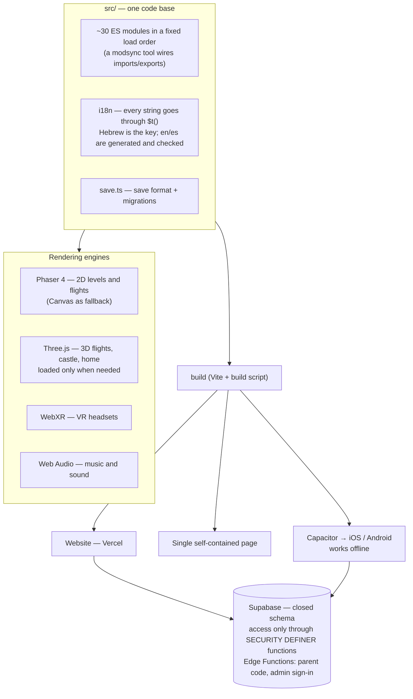
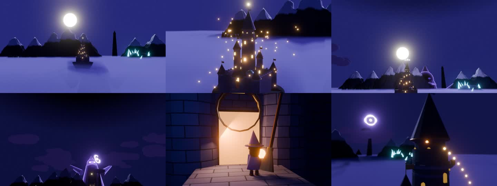

# Tower of Mist

**🟢 Live on the web: [migdal-haarafel.vercel.app](https://migdal-haarafel.vercel.app) · 🟡 heading to the App Store and Google Play**

> An original adventure game set in a magic academy — built for a child and together with him, and now for other kids too.

▶️ [The full opening film (36 seconds)](../assets/migdal-haarafel/intro.mp4)

| | |
|---|---|
| **Audience** | Kids aged 6–11 (store Kids categories 6–8 and 9–11) |
| **Languages** | English, Hebrew, Spanish — both right-to-left and left-to-right |
| **Platforms** | Browser (phone, tablet, computer), VR headsets (WebXR), iOS and Android via Capacitor |
| **Scale** | 2 seasons · 82 levels · ~650 commits · 218 automated test files |
| **Cadence** | In active development, with a "what's new" note for players in every release |

## The story
The game began as a 9-year-old's wish for "a magic game of my own". He co-designs it, tests every build on a phone, and his bugs get fixed first. The principle — **"designed by a kid, for kids"** — is also its strongest marketing story.

## What's in the game
**World and gameplay**
- **Two seasons — 32 + 50 levels:** 2D ground levels, broom flights in 2D and 3D, and free flight in open skies.
- **A 3D castle** that serves as the hub, and a personal home you can furnish.
- **The Mist Arena**, mini-games, **potion brewing**, secrets with three riddle rooms, and achievements.
- **Two-player co-op** on the same device.
- **VR headsets:** the home and free flight run in WebXR, and a ground level appears as a magic table inside the headset.

**Learning inside the game**
- Maths, reading and a practised language (English, Spanish or Hebrew), from kindergarten to 6th grade — matched to the child's grade.
- **Riddles you must solve** to finish a level or win the arena — learning is part of progress, not a separate screen.
- Learning moments inside conversations with the characters.

**Parents and privacy**
- **A parents' area** protected by a personal 6-digit code sent by email (only a salted hash is stored): difficulty, learning content and free-play time.
- Local saves + **cloud saves** (family code, or an account with email / Google / Apple). Every version must load every old save.
- **A fair business model:** the app is free with a demo that needs no sign-up; one purchase through Apple/Google, behind a parental gate, unlocks the whole game. No coins for sale, no ads. Existing players kept the full game for free.

## Architecture

## Technologies
JavaScript/TypeScript · Vite · **Phaser 4** · **Three.js** · WebXR · Web Audio · Supabase (Postgres, Auth, Edge Functions) · Capacitor · Vercel · Playwright (Python) · Pillow

## How it's built — the AI workflow
- **Every round of work gets its own branch** with a Vercel preview link. It's tested on a phone, and `main` (the live game) moves only after an explicit "ship it".
- **Claude Code** writes the code, runs the tests and prepares the preview, using dedicated skills: `preview`, `release`, `test` and `ux-expert` — a player-experience review before and after every behaviour change.
- **A "what's new" popup in every release**, in three languages, shown once when a returning player enters the castle.
- **"No test leftovers in production":** the live build fails if any test switch remains in it.

## Testing (218 files)
- **Bots that play** every season-1 level (solo and co-op) and season 2.
- **Screen rules:** every screen and popup is checked on **9 devices** and in three languages — nothing past the edges, popups fit without scrolling.
- Bidirectional-text checks for every screen, touch joystick, sound, Phaser, 3D, the arena, autopilot flights.
- **Simulating iPhone-only bugs** that never happen in Chromium (lost touch lifts, sound taken away).
- Visual comparison between builds.

## Challenges and solutions (interview material)
- **Changing technology while the game is live:** a gradual move from Canvas to Phaser 4, and from Three.js r128 to r186 — without touching game logic, while preserving the original look (colour management, light intensities and falloff).
- **Splitting one huge script into modules** without breaking load order — a tool that derives the imports, exports and setters from the code itself.
- **One layout system** for every screen and popup, with a "spellbook" skin drawn only with backgrounds and shadows, so it never changes a size.
- **Children's privacy:** a checklist before a wide launch — a privacy policy, parental consent and in-game account deletion.

## Gallery

## Related
- [App Growth Kit](05-app-growth-kit.md) — how the game was promoted with no ad budget, by an agent running every hour.
- [Growth Engine](04-growth-engine.md) — the product that grew out of those lessons.
