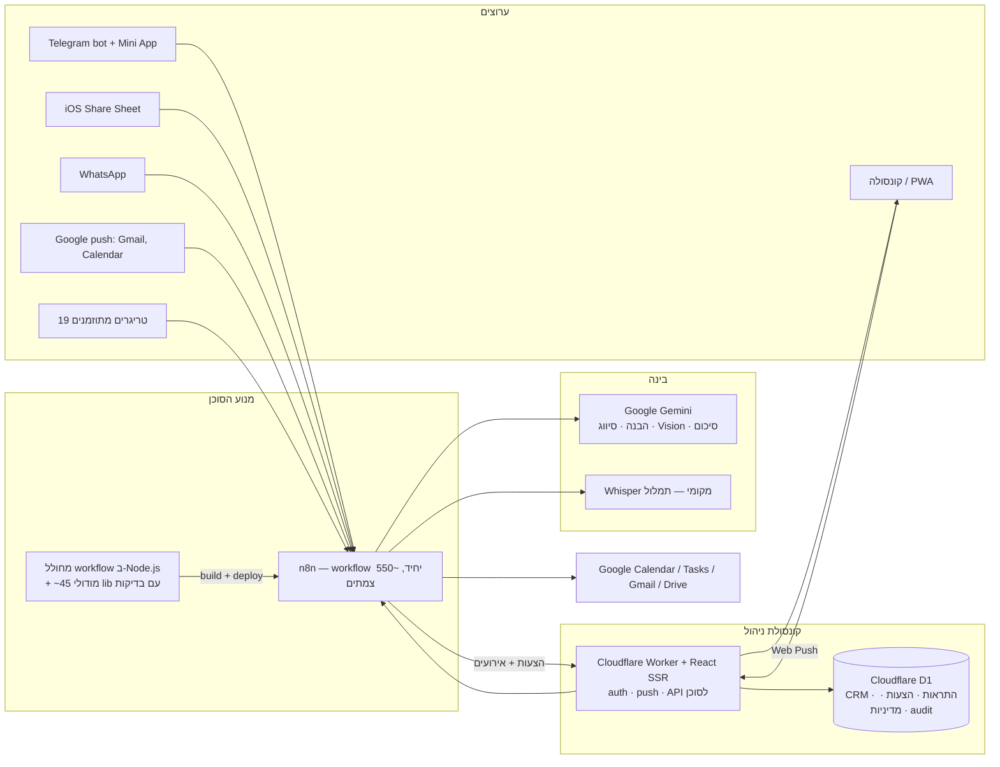
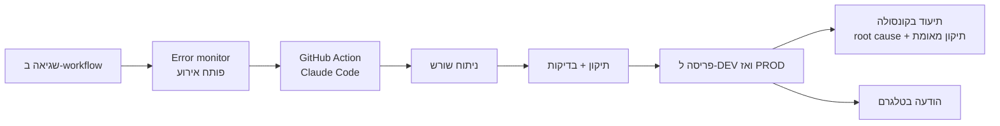

# Chief-of-Staff AI · סוכן אישי לניהול העסק

**🟢 בייצור · שימוש יומיומי מאז יולי 2026**

סוכן AI שמנהל את "הצד האדמיניסטרטיבי" של עסק ייעוץ ואימון: פגישות, מיילים, יומן, משימות, לידים, קבלות ותוכן. עובד מתוך טלגרם (בוט + Mini App), Share Sheet באייפון, וואטסאפ וקונסולת ניהול ב-PWA.

<!-- MEDIA: סרטון 60–90 שניות: הודעה קולית בטלגרם → סיכום פגישה → משימות ביומן → ליד ב-CRM -->

| | |
|---|---|
| **רכיבים** | מנוע סוכן (n8n) + קונסולת ניהול (Cloudflare Worker) — שני ריפוזיטוריז |
| **היקף** | ~490 קומיטים · ~410 PRs · 103 קבצי בדיקות · 41 מיגרציות DB · workflow של ~550 צמתים |
| **סביבות** | DEV ו-PROD נפרדות לגמרי |

## הבעיה
עצמאית שעובדת עם הרבה לקוחות במקביל, בשלושה "מרחבי עבודה" (אישי, אימון קריירה, ייעוץ ארגוני), מבלה שעות על תיאום, סיכומי פגישות, מעקב לידים, קבלות ומיילים. הכלים קיימים (Gmail, Calendar, Tasks, Drive), אבל אף אחד לא מחבר ביניהם ולא יוזם.

## מה הסוכן עושה

**פגישות ויומן**
- **סיכום פגישות:** הקלטה → תמלול (Whisper) → סיכום, החלטות ומשימות → הצעות לאישור.
- **יומן חכם:** זיהוי כפילויות, שיוך כל אירוע למרחב העבודה לפי צבע, "שומר אג'נדה" שמתריע על עומס.
- **איזון שבועי:** כמה זמן הלך לעבודה מכניסה מול עבודה אחרת, מול יעד.
- **ציר זמן אחד, כמה עדשות:** כל היום מוצג כרצף אחד ומסונן לפי מרחב.

**CRM ולידים**
- לידים, פעולות ומעקבים, כולל **סנכרון אוטומטי מהמייל**.
- עדכון CRM בשיחה חופשית בטלגרם.
- התראות על לידים שלא טופלו ותזכורות מעקב.

**משימות**
- **סיווג משימות שלומד מהבעלים:** למשימה ב-Google Tasks אין צבע או מרחב, אז הסוכן שואל — משימה אחת בכל פעם — ומכליל לחוקים לפי שמות. כשיש יותר משלוש משימות פתוחות, הוא שולח הפניה אחת למסך מיון במקום רצף שאלות.

**מיילים, קבלות ותוכן**
- **סינון רך והעברה חכמה** של מיילים, טיוטות תגובה.
- **קבלות והוצאות:** צילום בטלגרם, שיתוף מהאייפון או זיהוי במייל → מסמך מסודר עם כפתורי אישור.
- **מיחזור תוכן:** טקסט או סיכום → טיוטת פוסט בקול של אותו מרחב עבודה.
- **שאלות על הידע שלי:** חיפוש במסמכי Drive המותרים לאותו מרחב, עם ציטוט המקור.

**יוזמה (Proactive)** — 19 שרשראות מתוזמנות: חידוש Gmail push, סנכרון CRM, בדיקת בריאות חיבורים, הצעות ליומן, איזון שבועי, שומר שגרה ועוד.

## אמון ושקיפות — Action Proposal Ledger
כל פעולה שכותבת החוצה (אירוע ביומן, מייל, עדכון CRM) הופכת קודם ל**הצעה מתועדת**:
- **12 סוגי פעולות** ממופים ל**רמות סיכון 0–4** (פעולה לא מוכרת → רמה 4, נכשל-בטוח).
- **מדיניות בגרסאות:** שינוי ברמת סיכון = גרסת מדיניות חדשה, כך שכל הצעה ישנה מתפרשת לפי החוקים שסיווגו אותה.
- **זיהוי כפילויות סמנטי:** אותה פעולה שהוצעה פעמיים מסומנת.
- **מסך "שקיפות הסוכן"** בקונסולה: מה הוצע → מה בוצע → מה ממתין → בריאות חיבורים → המדיניות בתוקף.
- כפתורי טלגרם **רק רלוונטיים להקשר** (לאשר / לערוך / לדחות) — בלי כפתורים גנריים.

## ארכיטקטורה

### תיקון תקלות עצמאי (Self-healing)

הצנרת רצה על מנוי Claude (טוקן OAuth) ולא על API בתשלום לפי שימוש — אין עלות משתנה לכל תיקון.

## טכנולוגיות
| שכבה | טכנולוגיה |
|---|---|
| אורקסטרציה | n8n ב-Docker Compose; ה-workflow נוצר מקוד JS ולא נערך ידנית בממשק |
| AI | Google Gemini (Flash / Flash-Lite), Whisper בקונטיינר, Claude Code ל-self-healing |
| קונסולה | Cloudflare Workers, React 19 SSR, Cloudflare D1 (SQLite), Web Push, PWA |
| אינטגרציות | Telegram Bot API, Gmail, Google Calendar, Tasks, Drive, WhatsApp |
| DevOps | GitHub Actions, Claude Code Action, סקריפטי פריסה עם אימות |
| בדיקות | Node test runner, בדיקות SQLite ל-D1, בדיקות "drift" בין הסוכן לקונסולה |

## Deployment
- **שתי סביבות** (DEV / PROD), כל אחת עם דומיין, טוקנים, מסד נתונים ו-workflow משלה.
- n8n רץ ב-Docker Compose על שרת ענן מאחורי Cloudflare; **הסודות הוצאו מה-workflow** למשתני סביבה, והייצוא החי מכיל אפס סודות.
- הקונסולה מוגנת ו**נכשלת-סגור** אם הסודות חסרים. הדפדפן מקבל רק תמונות-מצב מנוקות — אף פעם לא טוקנים, תוכן מיילים או היסטוריית צ'אט.
- פריסת הסוכן: push → restart → אימות שהטריגרים חזרו לפעול. פריסת הקונסולה: מיגרציות קודם, אחר כך הקוד, ואז בדיקה שהשירות מחובר למסד הנכון.
- **פרופיל "קבלות בלבד":** משתנה אחד מכבה את כל הסוכן חוץ מצנרת הקבלות — בלי למחוק כלום.

## אתגרים ופתרונות (חומר לראיון)
- **"פריסה שקטה שהורגת טריגרים":** עדכון workflow דרך ה-API מדווח הצלחה, אבל לא מפעיל מחדש טריגרים מתוזמנים. הפתרון: פריסה שתמיד כוללת restart ובדיקת זמן העלייה.
- **"מסך ריק שנראה תקין":** פריסה ידנית חיברה את הייצור למסד של סביבת הפיתוח, והמסכים פשוט היו ריקים בלי שגיאה. הפתרון: אימות חיבור אוטומטי בסוף כל פריסה.
- **הרשאות Google שפגו כל 7 ימים:** התברר שזה מצב "Testing" של מסך ההסכמה. הפתרון: מעבר לייצור וחידוש ההסכמה לכל חיבור.
- **כשלים שקטים:** מיפוי מספרי של כל הצמתים שבולעים שגיאות, סיווג ידני, וניטור שפותח אירוע.
- **שני ריפוזיטוריז שחייבים להסכים:** בדיקות drift שנכשלות אם הסיווג, צבעי האיזון או מדיניות הסיכון בסוכן ובקונסולה מתפצלים.
- **תיעוד לפני שינוי:** מלאי מערכת, מפת זרימת מידע, מודל איום ובסיס עלויות — לפני כל שינוי מבני.

## מדיה להוסיף
- [ ] צילום קונסולה: היום, CRM, שקיפות הסוכן — **עם נתוני דמו**
- [ ] GIF של שיחה בטלגרם עם כפתורי אישור
- [ ] צילום של דף "אירוע ותיקון"
