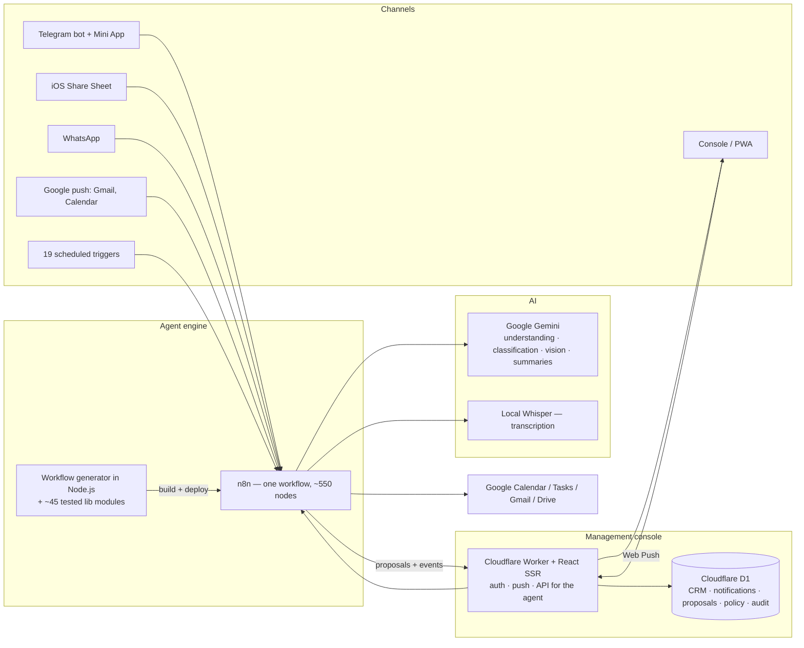
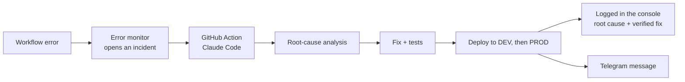

# Chief-of-Staff AI — a personal agent for running the business

**🟢 In production · used daily since July 2026**

An AI agent that handles the administrative side of a consulting and coaching business: meetings, email, calendar, tasks, leads, receipts and content. It works from Telegram (bot + Mini App), the iPhone Share Sheet, WhatsApp and a PWA management console.

<!-- MEDIA: 60–90 s video: a Telegram voice note → meeting summary → tasks in the calendar → a lead in the CRM -->

| | |
|---|---|
| **Components** | Agent engine (n8n) + management console (Cloudflare Worker) — two repositories |
| **Scale** | ~490 commits · ~410 PRs · 103 test files · 41 database migrations · a ~550-node workflow |
| **Environments** | Fully separate DEV and PROD |

## The problem
A solo consultant working with many clients at once, across three "workspaces" (personal, career coaching, organisational consulting), spends hours on scheduling, meeting summaries, lead follow-up, receipts and email. The tools exist (Gmail, Calendar, Tasks, Drive), but nothing connects them and nothing takes initiative.

## What the agent does

**Meetings and calendar**
- **Meeting summaries:** recording → transcription (Whisper) → summary, decisions and tasks → proposals for approval.
- **Smart calendar:** duplicate detection, assigning each event to a workspace by colour, an "agenda guard" that warns about overload.
- **Weekly balance:** how much time went to revenue work versus other work, against a target.
- **One timeline, several lenses:** the whole day as one sequence, filtered by workspace.

**CRM and leads**
- Leads, actions and follow-ups, including **automatic sync from email**.
- Updating the CRM in free conversation on Telegram.
- Alerts for untouched leads and follow-up reminders.

**Tasks**
- **Task classification that learns from the owner:** a Google Task has no colour or workspace, so the agent asks — one task at a time — and generalises into rules based on names. With more than three open tasks, it sends one pointer to a triage screen instead of a stream of questions.

**Email, receipts and content**
- **Soft filtering and smart forwarding** of email, reply drafts.
- **Receipts and expenses:** a photo on Telegram, a share from the iPhone or detection in email → a tidy document with approval buttons.
- **Content repurposing:** a text or summary → a post draft in that workspace's voice.
- **Questions about my own knowledge:** searching the Drive documents allowed for that workspace, citing the source.

**Proactive** — 19 scheduled chains: Gmail push renewal, CRM sync, connection health checks, calendar suggestions, weekly balance, routine guard and more.

## Trust and transparency — the Action Proposal Ledger
Every action that writes to the outside world (a calendar event, an email, a CRM update) first becomes a **recorded proposal**:
- **12 action kinds** mapped to **risk tiers 0–4** (an unknown action → tier 4, fail-safe).
- **Versioned policy:** changing a risk tier means a new policy version, so every old proposal is read against the rules that classified it.
- **Semantic duplicate detection:** the same action proposed twice is flagged.
- **An "agent transparency" screen** in the console: proposed → done → waiting → connection health → policy in force.
- Telegram buttons are **only the ones relevant to the context** (approve / edit / reject) — no generic buttons.

## Architecture

### Self-healing incident repair

The pipeline runs on a Claude subscription (OAuth token) rather than a pay-per-use API key, so a fix has no variable cost.

## Technologies
| Layer | Technology |
|---|---|
| Orchestration | n8n on Docker Compose; the workflow is generated from JS code, not edited by hand in the UI |
| AI | Google Gemini (Flash / Flash-Lite), Whisper in a container, Claude Code for self-healing |
| Console | Cloudflare Workers, React 19 SSR, Cloudflare D1 (SQLite), Web Push, PWA |
| Integrations | Telegram Bot API, Gmail, Google Calendar, Tasks, Drive, WhatsApp |
| DevOps | GitHub Actions, Claude Code Action, deploy scripts with verification |
| Testing | Node test runner, SQLite tests for D1, "drift" tests between the agent and the console |

## Deployment
- **Two environments** (DEV / PROD), each with its own domain, tokens, database and workflow.
- n8n runs on Docker Compose on a cloud server behind Cloudflare; **secrets were moved out of the workflow** into environment variables, and the live export contains zero secrets.
- The console is protected and **fails closed** if its secrets are missing. The browser only receives sanitised snapshots — never tokens, email content or chat history.
- Agent deploy: push → restart → verify the triggers are running again. Console deploy: migrations first, then the code, then a check that the service is bound to the right database.
- **A "receipts-only" profile:** one variable switches off everything except the receipt pipeline — without deleting anything.

## Challenges and solutions (interview material)
- **"A silent deploy that kills triggers":** updating the workflow through the API reports success but doesn't re-arm scheduled triggers. Fix: every deploy includes a restart and a check of the container start time.
- **"An empty screen that looks fine":** a manual deploy bound production to the development database, and screens were simply empty with no error. Fix: an automatic binding check at the end of every deploy.
- **Google permissions expiring every 7 days:** the consent screen was in "Testing" status. Fix: moving it to production and re-consenting every connection.
- **Silent failures:** counting every node that swallows errors, classifying them by hand, and monitoring that opens an incident.
- **Two repositories that must agree:** drift tests fail if the classifier, balance colours or risk policy diverge between the agent and the console.
- **Document before changing:** a system inventory, data-flow map, threat model and cost baseline before any structural change.

## Media to add
- [ ] Console screenshots: today, CRM, agent transparency — **with demo data**
- [ ] GIF of a Telegram conversation with approval buttons
- [ ] Screenshot of an "incident and fix" page
