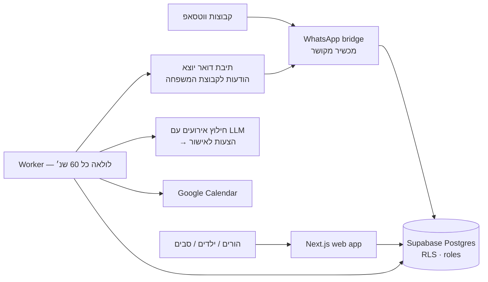

# השנה שלנו · מתכנן שנתי למשפחה

**🟢 חי למשפחה ראשונה · בבנייה מאז אוקטובר 2026**

> כל השנה של המשפחה — מראש, במקום אחד, בלי להקליד. מהגן ועד סבתא, כולם יודעים מה קורה.

<!-- MEDIA: צילומי מסך עם המשפחה הבדויה "משפחת כהן" בלבד -->
<!--  -->

## הבעיה
יומנים משפחתיים (Cozi, TimeTree ועוד) דורשים שמישהו יקליד הכול, לא מכירים את השנה הישראלית (לוח משרד החינוך, בגרויות, ערבי חג, טסט) ובנויים סביב מייל — בזמן שהמשפחה הישראלית חיה בווטסאפ.

## מה המוצר עושה
- **טוען מראש את כל השנה:** חופשות משרד החינוך לכל ילד לפי שכבה, חגים, ימי הולדת (כולל תאריך עברי), חידושי דרכון, רישיון וטסט.
- **קליטה בלי הקלדה:** טקסט, צילום, הודעה קולית או הודעה בקבוצת ווטסאפ → **הצעה** שמאשרים בנגיעה.
- **תובנות לילה:** בודק כל לילה התנגשויות ו"חורים" בהשגחה על הילדים.
- **כל דור בערוץ שלו:** מצב הורים, מצב ילד (9), מצב סבתא (80); הודעת "מחר אצלנו" ו"השבוע שלנו" לקבוצת המשפחה.
- **סנכרון ל-Google Calendar** של ההורים.

## ארכיטקטורה

## טכנולוגיות
Next.js · TypeScript · Supabase (Postgres, Auth, RLS) · Worker ב-TypeScript · גשר ווטסאפ (Baileys) · Claude לחילוץ מידע · Google Calendar API · Resend · Docker Compose · Vitest + Playwright + evals לחילוץ

## Deployment
- שלושה קונטיינרים (web, worker, whatsapp-bridge) ב-Docker Compose על שרת ARM קטן.
- פריסה בסקריפט: בדיקות → build → העלאה → restart → בדיקת בריאות; התמונה הקודמת נשמרת ל-rollback מיידי.
- **לוגים בלי תוכן** — רק מזהים, מצבים ומספרים. כל שלב בלולאה עם deadline משלו.
- מיגרציות עם כלי שבודק התאמה בין הקוד ל-DB החי.

## איפה AI נכנס
- **חילוץ אירועים** מטקסט חופשי, צילום חוזר מבית הספר או הקלטה — תמיד כהצעה, אף פעם לא ישר ליומן.
- **Evals** ייעודיים שמודדים את איכות החילוץ על דוגמאות אמיתיות-מומצאות.
- **מחקר שוק** של כ-20 מוצרים כבסיס למיצוב ("אמינות וייצוא חשובים יותר מעוד פיצ'ר").

## אתגרים ופתרונות
- **אמון:** התלונה הנפוצה על עוזרי AI היא "צריך לבדוק שוב שזה נכנס". לכן כל קליטה היא הצעה עם אישור, וכל מה שנכנס מוצג בחזרה.
- **שבת וחגים:** חלונות שקטים שבהם לא נשלחות הודעות.
- **ריבוי מכשירים:** טיפול בניתוק כפוי כשאותה סשן רצה ב-Safari ובאפליקציה מסך הבית.

## מדיה להוסיף
- [ ] מסך השנה / החודש עם המשפחה הבדויה
- [ ] GIF: צילום חוזר מבית הספר → הצעה → אישור
- [ ] מסך "מצב סבתא"
