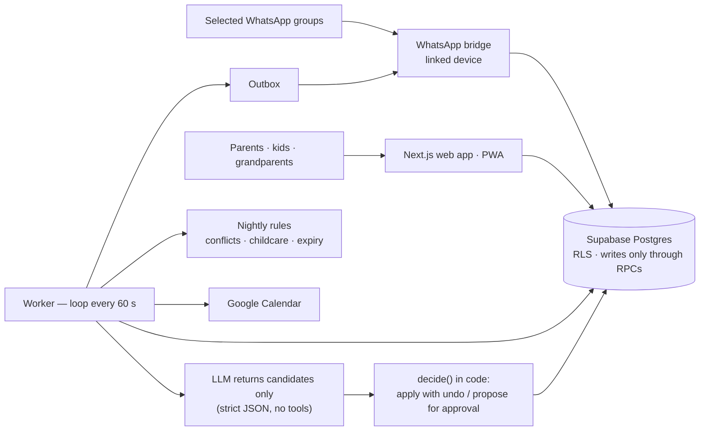

# Our Year (FamiSync) — a family year planner

**🟢 Live for a first family · in development since October 2026**

> The whole family year — in advance, in one place, without typing. From kindergarten to grandma, everyone knows what's happening.

<!-- MEDIA: screenshots with the fictional "Cohen family" only -->

| | |
|---|---|
| **Scale** | ~660 commits and PRs in under two months · 564 test files · 148 migrations · 88 decision records (ADRs) |
| **Research** | 13 research documents: competitors, languages, calendars by country and tradition, chores, grades, motivation and school systems |
| **Languages** | Hebrew (source), English at launch, more languages as data |

## The problem
Family calendars (Cozi, TimeTree, FamilyWall, GroupCal) need someone to type everything in. Kitchen displays (Skylight, Hearth) are expensive and not in Hebrew. "Snap it and we'll add it" AI assistants exist, but the standard complaint is "I have to check again that it really went in". **No product knows the Israeli year** — the Ministry of Education calendar, matriculation exams, holiday eves, the annual car test — and all of them are built around email, while Israeli families live on WhatsApp.

## What the product does

**Loads the whole year in advance**
- School holidays for each child by sector and stage, holidays (including Hebrew dates), birthdays, passport, licence, car test and insurance renewals.
- **The calendar the family chooses:** the national holiday calendar by default, other communities' calendars or a trip destination's as data — **without ever asking about religion**.

**Capture without typing**
- Reads the WhatsApp groups the owner selected — **in the context of the conversation and the calendar**, not one message at a time.
- **"What code can prove goes in; everything else is a proposal":** a certain change is applied automatically, marked "added automatically · from X's message" with one-tap undo. Anything uncertain goes to a "to approve" queue with one precise question.
- Text, photo, file or voice note — the same pipeline.

**Insights and reminders**
- **Deterministic rules** that run every night: conflicts, gaps in childcare, a passport expiring before a flight, a drive that clashes with busy time in the calendar.
- **Everyone on their own channel and in their own language:** push for parents, WhatsApp for grandparents, "My day" for young children. "Tomorrow at home" and "Our week" for the family group.
- **Quiet hours** on Shabbat and holidays, as the family chose.

**Family modules**
- **Household chores:** a fair planner (code, not a model) that splits by presence and effort, "children first". No comparisons, no "you missed it", no leaderboards.
- **Grades and tests:** each child compared only with their own history; a score never leaves the app (not in a notification, not on WhatsApp).
- **A family goal and stars** — for effort, never for grades.
- **Textbooks and homework:** the book's table of contents, and a homework line matched to a chapter by page numbers — in code, not by a model.
- **Sync to each parent's Google Calendar** (one way), with busy times coming back — without titles.
- **Display modes:** parents, child (9), grandma (80) — each with the language and sentence length that suits them.

## Architecture

## Technologies
Next.js 16 · React 19 · TypeScript strict · Tailwind 4 · shadcn/ui · next-intl · TanStack Query · Supabase (Postgres, Auth, RLS) · TypeScript worker · WhatsApp bridge (Baileys) · **Claude** (Haiku / Sonnet) for extraction and verification · Hebcal · Google Calendar API · Resend · Docker Compose · Cloudflare Tunnel · Vitest · Playwright (3 devices) · PGlite for schema tests

## Deployment
- Three containers (web, worker, WhatsApp bridge) on Docker Compose on a small ARM server, behind Cloudflare.
- Scripted deploy: tests → build → upload → restart → health check; the previous image is kept for instant rollback.
- **Logs without content** — only IDs, states and counts. Every step of the loop has its own deadline.
- Migrations are generated from the data-model document and checked against the live database.

## Where AI is used — and where it deliberately isn't
- **The model never decides.** It returns candidates; a pure, versioned function in code decides what goes in.
- **Evals as a gate:** every prompt, model or schema change must pass — date accuracy ≥95% per language, recall ≥90%, zero wrong auto-applies.
- **What never reaches the model:** photos of ID documents, grades, motivation data, homework pages, and most of what children write.
- **Research:** ~20 products reviewed as the basis for positioning — "reliability and export matter more than another feature".

## Challenges and solutions
- **Trust:** every automatic capture is marked and undoable; everything else is a proposal.
- **Children's privacy:** reading grades is limited by age, a teenager sees first, and grades never leave the app.
- **Language and gender:** every sentence is a function of its recipient — language and grammatical gender, no slashes, with direction isolation for every number and phone.
- **Performance:** a per-tap request ceiling, checked in end-to-end tests, that can only go down.

## Media to add
- [ ] Year / month screen with the fictional family
- [ ] GIF: a school notice photo → proposal → approval
- [ ] "Grandma mode" and a child's "My day" screens
