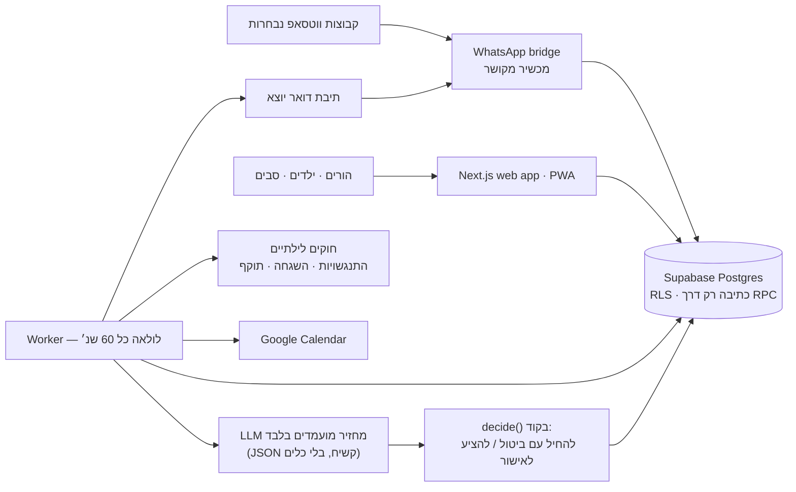

# השנה שלנו (FamiSync) · מתכנן שנתי למשפחה

**🟢 חי למשפחה ראשונה · בבנייה מאז אוקטובר 2026**

> כל השנה של המשפחה — מראש, במקום אחד, בלי להקליד. מהגן ועד סבתא, כולם יודעים מה קורה.

<!-- MEDIA: צילומי מסך עם המשפחה הבדויה "משפחת כהן" בלבד -->

| | |
|---|---|
| **היקף** | ~660 קומיטים ו-PRs בפחות מחודשיים · 564 קבצי בדיקות · 148 מיגרציות · 88 רשומות החלטה (ADR) |
| **מחקר** | 13 מסמכי מחקר: מתחרים, שפות, לוחות שנה לפי מדינה ומסורת, תורנויות, ציונים, מוטיבציה ומערכות בית ספר |
| **שפות** | עברית (מקור), אנגלית בהשקה, ועוד שפות כנתונים |

## הבעיה
יומנים משפחתיים (Cozi, TimeTree, FamilyWall, GroupCal) דורשים שמישהו יקליד הכול. מסכי מטבח (Skylight, Hearth) יקרים ולא בעברית. עוזרי AI "צלמו ונכניס" קיימים, אבל התלונה הקבועה היא "צריך לבדוק שוב שזה באמת נכנס". **אף מוצר לא מכיר את השנה הישראלית** — לוח משרד החינוך, בגרויות, ערבי חג, טסט לרכב — וכולם בנויים סביב מייל, בזמן שהמשפחה הישראלית חיה בווטסאפ.

## מה המוצר עושה

**טוען מראש את כל השנה**
- חופשות משרד החינוך לכל ילד לפי מגזר ושלב, חגים (כולל תאריך עברי), ימי הולדת, חידושי דרכון, רישיון, טסט וביטוח.
- **הלוח שהמשפחה בוחרת:** לוח החגים הלאומי כברירת מחדל, לוחות של קהילות אחרות או של יעד טיול כנתונים — **בלי לשאול אף פעם על דת**.

**קליטה בלי הקלדה**
- קורא את קבוצות הווטסאפ שהבעלים בחר — **בהקשר של השיחה ושל היומן**, לא הודעה בודדת.
- **"מה שהקוד יכול להוכיח — נכנס; כל השאר — הצעה":** שינוי ודאי נכנס אוטומטית, מסומן "נוסף אוטומטית · מהודעה של X" עם ביטול בנגיעה. כל דבר לא ודאי הולך לתור "לאישור" עם שאלה מדויקת אחת.
- טקסט, צילום, קובץ או הודעה קולית — אותה צנרת.

**תובנות ותזכורות**
- **חוקים דטרמיניסטיים** שרצים כל לילה: התנגשויות, "חור" בהשגחה על הילדים, דרכון שפג לפני טיסה, נסיעה שמתנגשת בזמן תפוס ביומן.
- **כל אחד בערוץ שלו ובשפה שלו:** push להורים, וואטסאפ לסבים, "היום שלי" לילדים צעירים. "מחר אצלנו" ו"השבוע שלנו" לקבוצת המשפחה.
- **שעות שקטות** בשבת ובחגים, לפי מה שהמשפחה בחרה.

**מודולים למשפחה**
- **תורנויות בית:** מתכנן הוגן (קוד, לא מודל) שמחלק לפי נוכחות ומאמץ, "הילדים קודם". בלי השוואות, בלי "פספסת", בלי טבלאות דירוג.
- **ציונים ומבחנים:** כל ילד מול ההיסטוריה של עצמו בלבד; ציון לא יוצא אף פעם מהאפליקציה (לא בהתראה, לא בווטסאפ).
- **מטרה משפחתית וכוכבים** — על מאמץ, אף פעם לא על ציונים.
- **ספרי לימוד ושיעורי בית:** תוכן העניינים של הספר, ושורת שיעורי בית שמותאמת לפרק לפי מספרי העמודים — בקוד, לא במודל.
- **סנכרון ליומן Google** של כל הורה (כיוון אחד), וזמנים תפוסים בחזרה — בלי כותרות.
- **מצבי תצוגה:** הורים, ילד (9), סבתא (80) — כל אחד בשפה ובאורך משפט שמתאימים לו.

## ארכיטקטורה

## טכנולוגיות
Next.js 16 · React 19 · TypeScript strict · Tailwind 4 · shadcn/ui · next-intl · TanStack Query · Supabase (Postgres, Auth, RLS) · Worker ב-TypeScript · גשר ווטסאפ (Baileys) · **Claude** (Haiku / Sonnet) לחילוץ ואימות · Hebcal · Google Calendar API · Resend · Docker Compose · Cloudflare Tunnel · Vitest · Playwright (3 מכשירים) · PGlite לבדיקות סכמה

## Deployment
- שלושה קונטיינרים (web, worker, whatsapp-bridge) ב-Docker Compose על שרת ARM קטן, מאחורי Cloudflare.
- פריסה בסקריפט: בדיקות → build → העלאה → restart → בדיקת בריאות; התמונה הקודמת נשמרת ל-rollback מיידי.
- **לוגים בלי תוכן** — רק מזהים, מצבים ומספרים. לכל שלב בלולאה deadline משלו.
- מיגרציות נוצרות מתוך מסמך מודל הנתונים, ונבדקות מול ה-DB החי.

## איפה AI נכנס — ואיפה בכוונה לא
- **המודל אף פעם לא מחליט.** הוא מחזיר מועמדים; פונקציה טהורה ומגורסת בקוד מחליטה מה נכנס.
- **Evals כשער:** כל שינוי בפרומפט, במודל או בסכמה חייב לעבור — דיוק תאריכים ≥95% לכל שפה, recall ≥90%, אפס החלות שגויות.
- **מה לא מגיע למודל:** תמונות של מסמכים מזהים, ציונים, נתוני מוטיבציה, דפי שיעורי בית, ורוב מה שילדים כותבים.
- **מחקר:** ~20 מוצרים נסקרו כבסיס למיצוב — "אמינות וייצוא חשובים יותר מעוד פיצ'ר".

## אתגרים ופתרונות
- **אמון:** כל קליטה אוטומטית מסומנת וניתנת לביטול, וכל השאר הוא הצעה.
- **פרטיות ילדים:** קריאת ציונים מוגבלת לפי גיל, נער מתבגר רואה ראשון, ואין ציונים מחוץ לאפליקציה.
- **שפה ומגדר:** כל משפט הוא פונקציה של הנמען — שפה ומין דקדוקי, בלי לוכסנים, עם בידוד כיוון לכל מספר וטלפון.
- **ביצועים:** תקרת בקשות לכל לחיצה, שנבדקת ב-E2E ויכולה רק לרדת.

## מדיה להוסיף
- [ ] מסך שנה / חודש עם המשפחה הבדויה
- [ ] GIF: צילום חוזר מבית הספר → הצעה → אישור
- [ ] מסך "מצב סבתא" ו"היום שלי" לילד
