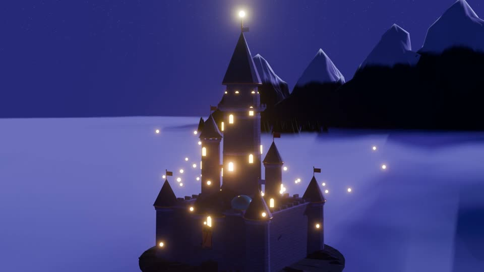
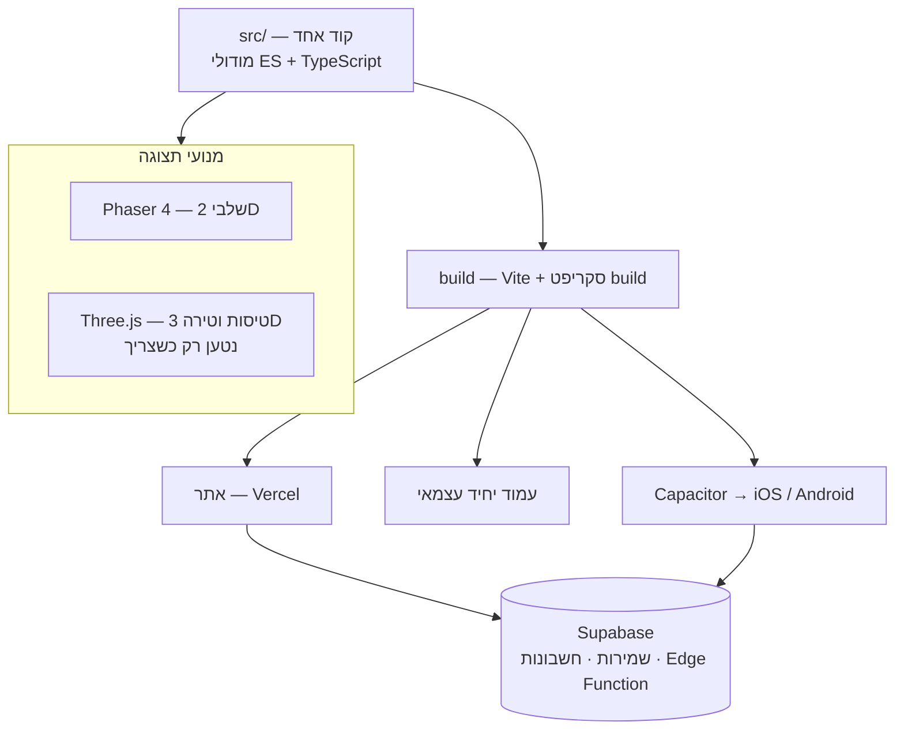

# מגדל הערפל · Tower of Mist

**🟢 אתר חי · 🟡 בדרך ל-App Store ו-Google Play**

משחק הרפתקאות מקורי באקדמיה לקסמים, לילדים בגילאי 6–11. הלמידה (חשבון, קריאה ושפות) מותאמת לכיתה של הילד ושזורה במשחק עצמו. עברית, אנגלית וספרדית. מחשב ומגע.

<!-- MEDIA: טריילר 30–45 שניות מתוך המשחק (יש כבר קטעי פתיחה בריפו המקורי) -->

## מה יש במשחק
- **שתי עונות, 82 שלבים** — שלבי קרקע ב-2D, טיסות ב-3D, טיסה חופשית וטירה תלת-ממדית כ-hub.
- **למידה בכיתה של הילד:** מגן ועד כיתה ו׳ — חשבון, קריאה, ושפה נלמדת (אנגלית, ספרדית או עברית).
- **חידות שצריך לפתור** כדי לסיים שלב, זירה, מיני-משחקים, רקיחת שיקויים, הישגים וסודות.
- **שמירה בענן:** קוד משפחתי או חשבון (מייל, Google, Apple).
- **בנוי עם ילד:** הרעיון והעיצוב נולדו מבן 9 — "designed by a kid, for kids".

## ארכיטקטורה

## טכנולוגיות
JavaScript/TypeScript · Vite · Phaser 4 · Three.js · Supabase (Postgres, Auth, Edge Functions) · Capacitor · Vercel · Playwright (Python) · מנוע i18n לשלוש שפות

## Deployment
- כל שינוי בענף משלו עם קישור תצוגה מקדימה ב-Vercel; `main` רק אחרי אישור.
- חלוקת קבצים: Three.js נטען בנפרד רק כשנפתחת סצנה תלת-ממדית — טעינה ראשונה מהירה.
- תוכנית חנויות: Capacitor עוטף את ה-build כאפליקציה שעובדת גם אופליין, עם שער הורים ובלי קישורים חיצוניים (דרישות קטגוריית Kids).

## איפה AI נכנס
- **פיתוח:** המשחק נבנה בסבבים עם Claude Code — כל סבב ענף, preview ובדיקות.
- **בדיקות אוטומטיות:** בוטים שמשחקים כל שלב, בדיקת חפיפה של חלונות קופצים, צילומי מסך והשוואה בין builds, על 9 גדלי מסך.
- **שיווק:** ראו [App Growth Kit](05-app-growth-kit.md).

## אתגרים ופתרונות
- **מעבר טכנולוגי בזמן שהמשחק חי:** מעבר הדרגתי ל-Phaser ולגרסה חדשה של Three.js בלי לשנות את לוגיקת המשחק (כולל שימור המראה המקורי של התאורה).
- **מכשירים אמיתיים:** תיקוני מגע וסאונד ספציפיים לאייפון.
- **פרטיות ילדים:** רשימת משימות לפני השקה רחבה — מדיניות פרטיות, הסכמת הורה, מחיקת חשבון מתוך המשחק.

## מדיה להוסיף
- [ ] טריילר קצר
- [ ] 3–4 צילומי מסך: שלב 2D, טיסה 3D, חידת למידה, מסך הורים
