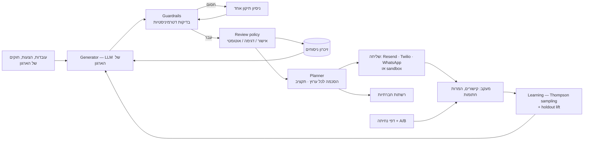

# Growth Engine · מערכת שיווק לארגונים

**🟢 באוויר עם ארגון הדגמה (sandbox) · 🟡 לפני חיבור ספקי שליחה חיים**

> משווק מחבר את המערכות שלו, מגדיר מסעות שיווק, מקבל לידים ומדבר איתם — פשוט מספיק לאנשי שיווק לא טכניים. תוכן שנכתב, נבדק ומשתפר לבד, תחת שליטת האדם.

<!-- MEDIA: צילום תור האישור + דוח קמפיין עם lift + דף נחיתה עם A/B -->

| | |
|---|---|
| **התחלה** | נובמבר 2026, כהמשך לקידום של מגדל הערפל |
| **היקף** | 30 PRs בשבוע הראשון · 36+ בדיקות, כולל Postgres אמיתי ובידוד בין ארגונים |
| **מצב** | אפליקציה חיה ב-Vercel, cron כל 10 דקות, ארגון הדגמה בעברית |

## למה זה נבנה
בקידום של "מגדל הערפל" למדנו: רק טענות אמיתיות, מדידה של משלמים ולא של לייקים, ועצירה באזהרה הראשונה. Growth Engine הופך את הלקחים האלה למוצר רב-ארגוני (multi-tenant).

## מה המערכת עושה
| צורך | הפתרון |
|---|---|
| התאמה לתחום | **8 תבניות** (אפליקציית ילדים, מרפאה, איקומרס, B2B, עמותה, נדל"ן, קורסים, מסעדה) עם קול, ערוצים ואיסורים רגולטוריים |
| כתיבה בכמה שפות | המודל כותב כמה וריאנטים לכל ערוץ×שפה, כל אחד מזווית אחרת, ב-JSON מובנה |
| התאמה למדיה | חוקים לכל ערוץ: מייל (נושא, גוף, הסרה), SMS (ספירת מקטעים GSM/UCS-2, שורת הסרה), וואטסאפ (תבנית מאושרת) |
| **מניעת שגיאות** | בדיקות דטרמיניסטיות: מספר או מחיר שלא בעובדות, הצעה שפגה, דחיפות בלי תאריך אמיתי, קישור זר, מילה אסורה, שפה שגויה → נחסם. ניסיון תיקון אחד, ואם לא — נזרק |
| בקרה אנושית | מדיניות לכל ארגון: הכול לאישור / חימום + דגימה של X% / אוטומטי. בדיקה נוספת ברגע השליחה |
| זיכרון ניסוחים | עריכות (לפני→אחרי), דחיות עם סיבה וחוקים קבועים ("אף פעם לא 'זול'") נכנסים לפרומפט הבא |
| למידה | **Thompson sampling** בין וריאנטים; מפסיד יוצא רק אחרי מספיק ניסיונות; המנצח הופך לבסיס למתחרים חדשים |
| מדידה אמיתית | **קבוצת ביקורת (holdout)** למדידת lift, עלות להמרה, הכנסה |
| תקציב | תקרה חודשית לארגון, תקרת AI ותקציב לקמפיין; כל פעולה נבדקת מראש ונרשמת בספר חשבונות |
| מפתח AI לכל ארגון | Claude / OpenAI / Gemini; המפתח נשמר מוצפן (AES-256-GCM) וקשור לארגון |
| **דפי נחיתה** | דף לכל קהל, אירוע או הצעה, עם **A/B testing** (סיכוי להיות הטוב ביותר + פסק דין) וטופס ליד ששואל למה האדם מתעניין |
| **רשתות חברתיות** | טיוטות ופרסום, ומדריך חיבור צעד-אחר-צעד ל-11 רשתות (Instagram, Facebook, LinkedIn, TikTok, YouTube, Threads, X, Pinterest, Reddit, Google Business, WhatsApp) — כולל פרומפט ש-Claude in Chrome מבצע את השלבים יחד עם המשתמש |
| צוות | משתמשים ותפקידים (צופה / עורך / מנהל), הזמנות חד-פעמיות, נגישות ובחירת ערכת נושא |

## ארכיטקטורה

## טכנולוגיות
TypeScript · Next.js 16 · Postgres/Supabase עם **RLS לפי חברות בארגון** ותפקיד DB מוגבל · Vitest (כולל בדיקות על Postgres אמיתי) · Resend · Twilio · Meta WhatsApp Cloud API · Claude / OpenAI / Gemini · pg_cron · Vercel

## Deployment
- Vercel, עם פריסה אוטומטית מ-`main` ובדיקת גרסה דרך `/api/health`.
- pg_cron מפעיל תכנון ושליחה כל 10 דקות.
- סכמה נפרדת ב-Postgres, והאפליקציה מתחברת כתפקיד מוגבל.
- ערוץ שלא חובר שולח ל-sandbox — אפשר להריץ קמפיין שלם בלי לשלוח לאף אחד.

## הבא בתור (Roadmap)
1. **צינור לידים:** סטטוסים, ציר זמן של כל נגיעה, משימות מעקב ומסך ליד אחד.
2. **יומן:** Google ואז Microsoft 365, וקביעת שיחות של 15/30 דקות לפי זמן פנוי.
3. ממשק באנגלית, וריצות חיות מול ספקים עם מפתחות של ארגון אמיתי.

## למה זה מעניין
- **AI עם מעקות:** המודל כותב, אבל קוד דטרמיניסטי מחליט מה מותר לצאת.
- **אדם בלולאה שמלמד את המערכת:** כל עריכה הופכת לחוק או לדוגמה.
- **מדידה סטטיסטית אמיתית** במקום "הקמפיין קיבל הרבה קליקים".
