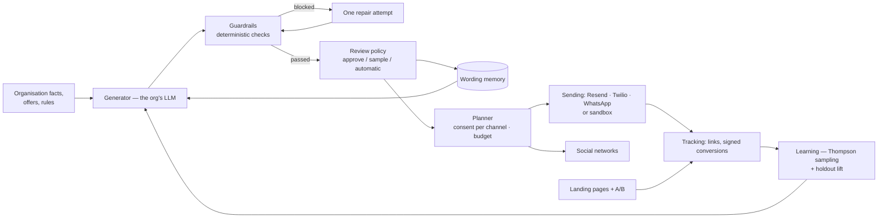

# Growth Engine — a marketing platform for organisations

**🟢 Live with a demo organisation (sandbox) · 🟡 before connecting live sending providers**

> A marketer connects their systems, sets up marketing journeys, gets leads and talks to them — simple enough for non-technical marketers. Content that is written, checked and improves on its own, under human control.

<!-- MEDIA: review queue + campaign report with lift + a landing page with A/B test -->

| | |
|---|---|
| **Started** | November 2026, as a follow-up to promoting Tower of Mist |
| **Scale** | 30 PRs in the first week · 36+ tests, including real Postgres and tenant isolation |
| **Status** | Live app on Vercel, cron every 10 minutes, a Hebrew demo organisation |

## Why it was built
Promoting Tower of Mist taught us: only true claims, measure paying users rather than likes, and stop at the first warning. Growth Engine turns those lessons into a multi-tenant product.

## What it does
| Need | Solution |
|---|---|
| Fit to the industry | **8 templates** (kids' app, clinic, e-commerce, B2B, non-profit, real estate, courses, restaurant) with voice, channels and regulatory restrictions |
| Writing in several languages | The model writes several variants per channel × language, each from a different angle, as structured JSON |
| Fit to the medium | Rules per channel: email (subject, body, unsubscribe), SMS (GSM/UCS-2 segment counting, opt-out line), WhatsApp (approved template) |
| **Preventing mistakes** | Deterministic checks: a number or price not in the facts, an expired offer, urgency without a real date, a foreign link, a banned word, the wrong language → blocked. One repair attempt; otherwise discarded |
| Human control | Per-organisation policy: approve everything / warm-up + X% sampling / automatic. A second check at send time |
| Wording memory | Edits (before → after), rejections with a reason and fixed rules ("never 'cheap'") go into the next prompt |
| Learning | **Thompson sampling** between variants; a loser leaves only after enough trials; the winner becomes the base for new challengers |
| Real measurement | **A holdout group** to measure lift, cost per conversion, revenue |
| Budget | A monthly cap per organisation, an AI cap and a per-campaign budget; every action is checked up front and recorded in a ledger |
| An AI key per organisation | Claude / OpenAI / Gemini; the key is stored encrypted (AES-256-GCM) and bound to the organisation |
| **Landing pages** | A page per audience, event or offer, with **A/B testing** (probability of being best + a verdict) and a lead form that asks why the person is interested |
| **Social networks** | Drafts and publishing, and a step-by-step connection guide for 11 networks (Instagram, Facebook, LinkedIn, TikTok, YouTube, Threads, X, Pinterest, Reddit, Google Business, WhatsApp) — including a prompt for Claude in Chrome to do the steps with the user |
| Team | Users and roles (viewer / editor / admin), one-time invites, accessibility and theme choice |

## Architecture

## Technologies
TypeScript · Next.js 16 · Postgres/Supabase with **RLS by organisation membership** and a restricted database role · Vitest (including tests on real Postgres) · Resend · Twilio · Meta WhatsApp Cloud API · Claude / OpenAI / Gemini · pg_cron · Vercel

## Deployment
- Vercel, auto-deploying from `main`, with a version check through `/api/health`.
- pg_cron triggers planning and sending every 10 minutes.
- A separate Postgres schema; the app connects as a restricted role.
- A channel that isn't connected sends to a sandbox — a whole campaign can run without messaging anyone.

## Next up (roadmap)
1. **Lead pipeline:** statuses, a timeline of every touch, follow-up tasks and one lead screen.
2. **Calendar:** Google, then Microsoft 365, and booking 15/30-minute calls from free time.
3. An English UI, and live runs against providers with a real organisation's keys.

## Why it's interesting
- **AI with guardrails:** the model writes, but deterministic code decides what may go out.
- **A human in the loop who teaches the system:** every edit becomes a rule or an example.
- **Real statistical measurement** instead of "the campaign got lots of clicks".
