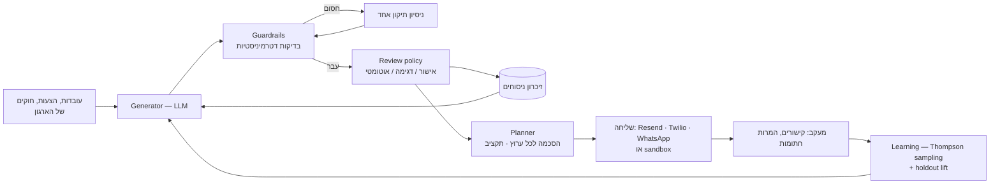

# Growth Engine · מנוע קמפיינים שיווקיים לארגונים

**🟡 ליבת המנוע ואפליקציית הווב מוכנות ונבדקו מקצה לקצה · לפני חיבור לספקים חיים**

> תוכן שנכתב, נבדק ומשתפר לבד — תחת שליטה של איש השיווק.

נבנה מהלקחים של קידום "מגדל הערפל": רק טענות אמיתיות, מדידה של משלמים ולא של לייקים, ועצירה באזהרה הראשונה. כאן אותם עקרונות הופכים למוצר רב-ארגוני (multi-tenant).

<!-- MEDIA: צילום תור האישור (approve / edit / reject) + דוח קמפיין עם lift -->

## מה המנוע עושה
| צורך | הפתרון |
|---|---|
| התאמה לתחום | 8 תבניות (אפליקציית ילדים, מרפאה, איקומרס, B2B, עמותה, נדל"ן, קורסים, מסעדה) עם קול, ערוצים ואיסורים רגולטוריים |
| כתיבה בכמה שפות | המודל כותב כמה וריאנטים לכל ערוץ×שפה, כל אחד מזווית אחרת, בפלט JSON מובנה |
| התאמה למדיה | חוקים לכל ערוץ: מייל, SMS (ספירת מקטעים, שורת הסרה), וואטסאפ (תבנית מאושרת) |
| **מניעת שגיאות** | בדיקות דטרמיניסטיות: מספר/מחיר שלא בעובדות, הצעה שפגה, דחיפות בלי תאריך, קישור זר → נחסם. ניסיון תיקון אחד, ואם לא — נזרק |
| בקרה אנושית | מדיניות לכל ארגון: הכול לאישור / דגימה של X% / אוטומטי. בדיקה נוספת ברגע השליחה |
| זיכרון ניסוחים | עריכות (לפני→אחרי), דחיות עם סיבה וחוקים קבועים נכנסים לפרומפט הבא |
| למידה | Thompson sampling בין וריאנטים; המנצח הופך לבסיס למתחרים חדשים |
| מדידה אמיתית | קבוצת ביקורת (holdout) למדידת lift, עלות להמרה, הכנסה |
| תקציב | תקרה חודשית לארגון, תקרת AI ותקציב לקמפיין, ספר חשבונות לפי עלות אמיתית |
| מפתח AI לכל ארגון | Claude / OpenAI / Gemini; המפתח נשמר מוצפן (AES-256-GCM) וקשור לארגון |

## ארכיטקטורה

## טכנולוגיות
TypeScript · Next.js · Postgres/Supabase עם RLS לפי חברות בארגון · Vitest (כולל בדיקות בידוד בין ארגונים על Postgres אמיתי) · Resend · Twilio · Meta WhatsApp Cloud API · Claude / OpenAI / Gemini · Vercel Cron

## Deployment
- Vercel + Supabase, crons לתכנון/שליחה ולמידה.
- משתמשים ותפקידים (צופה / עורך / מנהל) שנבדקים בכל עמוד ופעולה; קישורי הזמנה חד-פעמיים (נשמר רק hash).
- ערוץ שלא חובר שולח ל-sandbox — אפשר להריץ קמפיין שלם בלי לשלוח לאף אחד.

## למה זה מעניין
- **AI עם מעקות:** המודל כותב, אבל קוד דטרמיניסטי מחליט מה מותר לצאת.
- **אדם בלולאה שמלמד את המערכת:** כל עריכה הופכת לחוק או לדוגמה.
- **מדידה סטטיסטית אמיתית** במקום "הקמפיין קיבל הרבה קליקים".

## מדיה להוסיף
- [ ] אשף יצירת קמפיין
- [ ] תור אישור עם טקסט שנחסם ("50%" שלא קיים בעובדות)
- [ ] דוח וריאנטים
