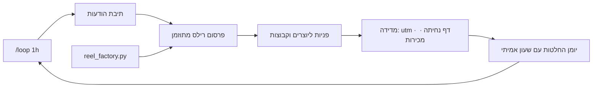

# App Growth Kit · קידום אורגני שמורץ ע"י סוכן

**🟢 בשימוש · קוד פתוח: [github.com/danidliod/app-growth-kit](https://github.com/danidliod/app-growth-kit)**

ערכה שנבנתה תוך כדי קידום משחק לימודי לילדים בלי תקציב פרסום: Claude Code מריץ "סבב" קבוע כל שעה בדפדפן — תיבת הודעות → פוסטים מתוזמנים → פניות ליוצרי תוכן ולקבוצות → מדידה → יומן.

<!-- MEDIA: GIF של סבב שעתי בדפדפן + דוגמה ל-3 רילס שנוצרו אוטומטית -->

| | |
|---|---|
| **קוד** | פתוח — זה הפרויקט היחיד כאן שהקוד שלו פומבי |
| **נולד מ** | שבוע של קידום [מגדל הערפל](01-tower-of-mist-game.md) |
| **המשך** | הלקחים הפכו למוצר [Growth Engine](04-growth-engine.md) |

## מה בפנים
- **Playbook** — השיטה המלאה, כולל פרק לינקדאין.
- **פרומפט לסבב שעתי** + 4 Skills ל-Claude Code: `growth-round`, `reel-factory`, `sales-check`, `linkedin-drafts`.
- **מפעל רילס** (Python): קליפ × הוק × שפה × פורמט (9:16 / 4:5 / 1:1), חידון עם ספירה לאחור, כרטיס מחיר, ולינק utm לכל וריאנט.
- **מדידת מכירות** מ-App Store Connect: הורדות מול רכישות בתשלום (בלי לספור קודי פרומו).
- **מעקב דף נחיתה** — אירועי ביקור ב-Supabase.

## הזרימה

## לקחים במספרים אמיתיים (שבוע ראשון)
- הורדות הגיעו, רכישות עוד לא — ולכן חשוב להבדיל בין הורדה, פרומו ותשלום.
- רוב המבקרים בדף הנחיתה הגיעו ממחשב → נוסף QR ליד הכפתור.
- רילס בעמוד פייסבוק קיבלו מאות צפיות כשפורסמו בקצב קבוע.
- **מעקות שנולדו מטעויות אמיתיות:** חותמת זמן אמיתית ביומן, בדיקה שהדף החי הוא שלנו לפני מדידה, אימות שהודעה באמת נשלחה.

## טכנולוגיות
Claude Code (skills, loop, הפעלת Chrome) · Python (ffmpeg) · App Store Connect API · Supabase · utm tracking

## עיקרון מרכזי
**הסוכן מכין, הבעלים מאשר:** כל שינוי בדף החנות, בדף הנחיתה או במחיר — רק אחרי אישור, עם תאריך ביומן. בלינקדאין — טיוטות בלבד.
