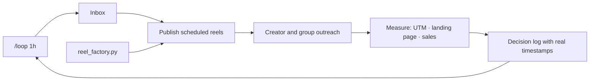

# App Growth Kit — organic promotion run by an agent

**🟢 In use · open source: [github.com/danidliod/app-growth-kit](https://github.com/danidliod/app-growth-kit)**

A kit built while promoting a kids' learning game with no ad budget: Claude Code runs a fixed "round" every hour in the browser — inbox → scheduled posts → creator and group outreach → measurement → log.

<!-- MEDIA: GIF of an hourly round in the browser + 3 auto-generated reels -->

| | |
|---|---|
| **Code** | Public — the only project here whose code is open |
| **Born from** | A week of promoting [Tower of Mist](01-tower-of-mist-game.md) |
| **Followed by** | The lessons became the [Growth Engine](04-growth-engine.md) product |

## What's inside
- **Playbook** — the full method, including a LinkedIn chapter.
- **An hourly-round prompt** + 4 Claude Code skills: `growth-round`, `reel-factory`, `sales-check`, `linkedin-drafts`.
- **Reel factory** (Python): clip × hook × language × format (9:16 / 4:5 / 1:1), a quiz with a countdown, a price card, and a UTM link per variant.
- **Sales measurement** from App Store Connect: downloads versus paid purchases (promo codes not counted).
- **Landing-page tracking** — visit events in Supabase.

## The loop

## Lessons in real numbers (first week)
- Downloads came, purchases didn't yet — so it matters to separate downloads, promo codes and payments.
- Most landing-page visitors came from desktop → a QR code was added next to the button.
- Facebook page reels got hundreds of views when posted at a steady pace.
- **Guardrails born from real mistakes:** real timestamps in the log, checking the live page is ours before measuring, and verifying a message was actually sent.

## Technologies
Claude Code (skills, loop, Chrome control) · Python (ffmpeg) · App Store Connect API · Supabase · UTM tracking

## Core principle
**The agent prepares, the owner approves:** any change to the store page, landing page or price happens only after approval, with a date in the log. On LinkedIn — drafts only.
