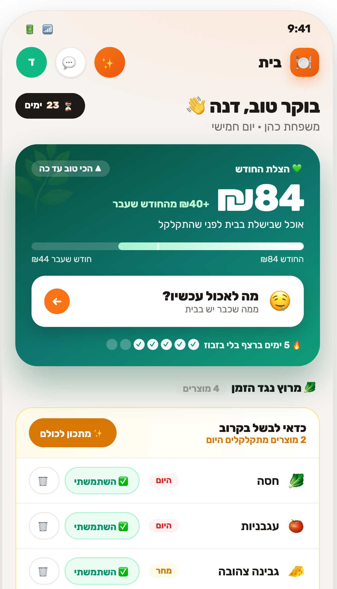
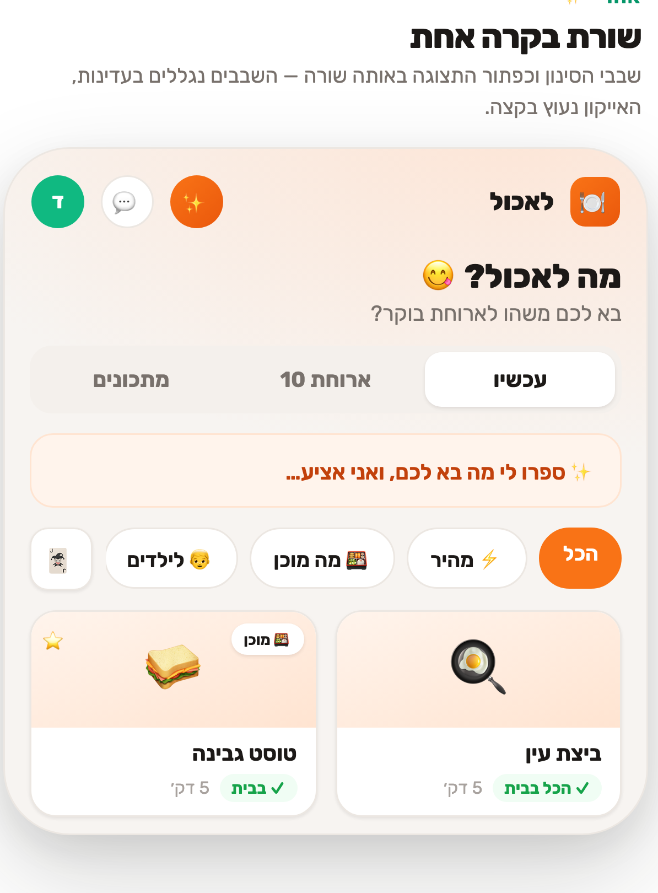
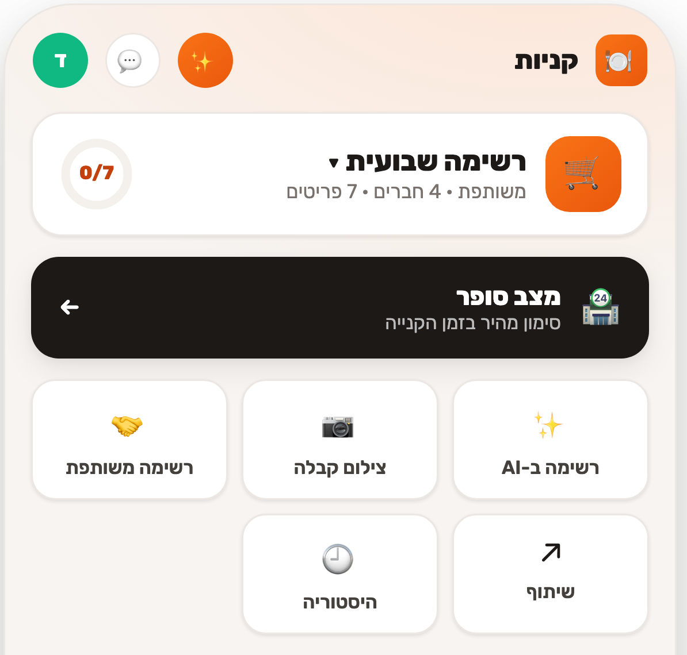
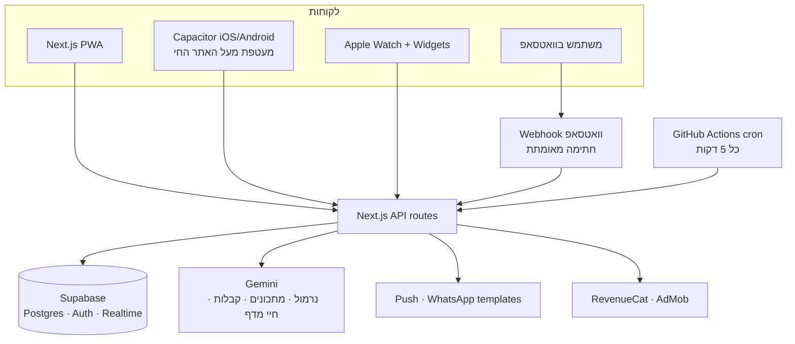
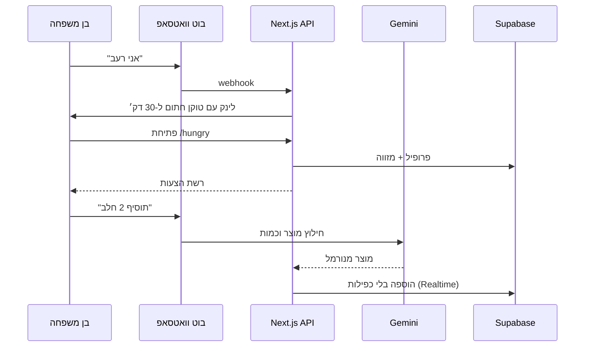

# imhungry · מה אפשר לאכול עכשיו?

**🟢 חי: [imhungry.appnest.fyi](https://imhungry.appnest.fyi) · אפליקציות iOS ו-Android (כולל Apple Watch ווידג'טים)**

> אפליקציית מטבח ישראלית שחוסכת כסף על ידי צמצום בזבוז מזון — "מה אפשר לאכול עכשיו ממה שכבר יש בבית?"

צילומי מסך מהעיצוב, עם משפחה לדוגמה.

| | |
|---|---|
| **התחלה** | מרץ 2026 |
| **היקף** | ~1,100 קומיטים · ~880 PRs · 331 קבצי בדיקות |
| **פלטפורמות** | ווב/PWA, iOS, Android, Apple Watch, וידג'טים, וואטסאפ |

## הבעיה
משפחות זורקות אוכל כי שוכחים מה יש במקרר, קונים כפילויות, ובכל בוקר מחדש שואלים "מה לשים לילדים בקופסה". אפליקציות מתכונים ותכנון ארוחות דורשות יותר מדי עבודה.

## מה האפליקציה עושה
- **"מה לאכול עכשיו?"** — הצעות לפי מה שיש בבית, מי אוכל (פרופיל לכל בן משפחה) ומה דחוף, עם סינונים (מהיר, מוכן, לילדים) ובקשה חופשית ("ספרו לי מה בא לכם").
- **"ארוחת 10"** — רעיונות לקופסת בית הספר, בלי צורך במקרר.
- **מתכונים מהמזווה** שנוצרים ב-AI, עם כמויות.
- **"מרוץ נגד הזמן"** — מה עומד להתקלקל, "השתמשתי" / "זרקתי" בנגיעה, והערכת חיי מדף.
- **"הצלת החודש"** — כמה כסף נחסך מאוכל שבושל לפני שהתקלקל, ורצף ימים בלי בזבוז.
- **רשימת קניות משותפת** בזמן אמת, לפי קטגוריות, עם **"מצב סופר"**, רשימה שנוצרת ב-AI, השלמה אוטומטית של מוצרים שנגמרים, והיסטוריה.
- **צילום קבלה** → המוצרים נכנסים למזווה אוטומטית (OCR + מיפוי שמות).
- **תכנון שבועי** ועגלה שבועית מוצעת.
- **וואטסאפ:** "אני רעב", "חסר חלב", "תוסיף 2 חלב" — ישר מהצ'אט, עם תזכורות יזומות בתבניות מאושרות.
- **Apple Watch ווידג'טים** למסך הבית.
- גיימיפיקציה, קופונים, הזמנת בני משפחה, מנוי (RevenueCat) ופרסומות (AdMob).

## ארכיטקטורה

### מווטסאפ לווב

## טכנולוגיות
Next.js 16 · React 19 · TypeScript strict · Tailwind v4 + shadcn/ui · Supabase (Postgres, Auth, Realtime) · Google Gemini · Meta WhatsApp Cloud API · Capacitor 8 · SwiftUI (Watch, Widgets) · RevenueCat · AdMob · Firebase (push) · Sentry · Serwist (PWA) · Vitest · Playwright · Vercel · GitHub Actions

## Deployment
- **האתר הוא האפליקציה:** המעטפת הנייטיב טוענת את האתר החי, כך שכל פריסה ב-Vercel מגיעה לאפליקציה בפתיחה הבאה. בילד חדש לחנויות רק כשמשהו נייטיב משתנה.
- סקריפט שחרור ל-iOS שמעדכן גרסה בכל ה-targets יחד (אפליקציה, שעון, וידג'טים).
- `pnpm ship`: בדיקות מקומיות → המתנה לפריסת Vercel → merge → ניקוי פריסות ישנות.
- סוכני קוד ייעודיים בריפו: מממש פיצ'רים, מתקן באגים (בדיקה נכשלת קודם), סוקר קוד ו-release captain.

## החלטות שמעניין לספר עליהן
- **AI רק איפה שטעות לא מסוכנת:** אלרגנים ובטיחות — חוקים קבועים, לא מודל.
- **נרמול שמות מוצרים במקום אחד:** אותו באג ("זה אותו מוצר?") חזר חמש פעמים, עד שכל ההשוואות עברו דרך מנרמל אחד עם eval על כל שורות הקבלות.
- **Cron אידמפוטנטי:** אחרי תקלה של הודעות כפולות, כל שליחה מתוזמנת מזוהה לפי חלון זמן.
- **עברית ואנגלית גם בשעון ובווידג'טים** — לפי שפת משק הבית, לא לפי המכשיר.
