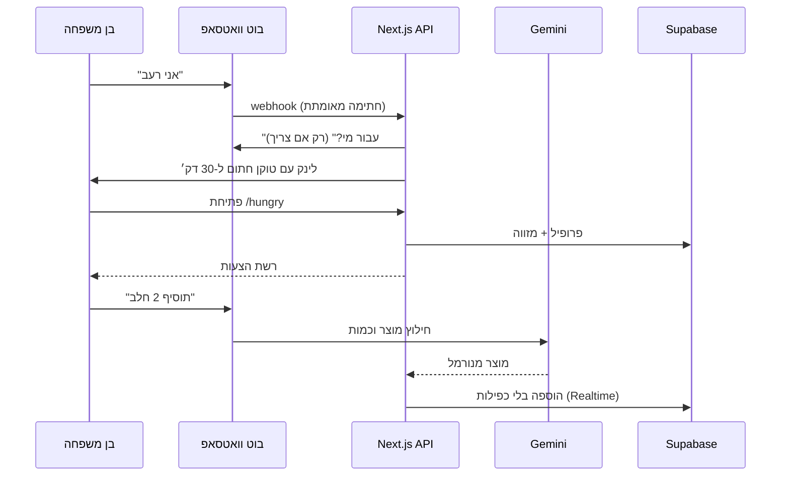

# imhungry · מה אפשר לאכול עכשיו?

**🟡 MVP · ווב + וואטסאפ + עטיפת iOS/Android**

עוזר אוכל משפחתי, וואטסאפ-תחילה: עונה על "מה אפשר לאכול עכשיו?", "מה לשים בקופסה לבית הספר?", ומנהל רשימת קניות משותפת וחכמה. לא מתכנן ארוחות, לא אפליקציית מתכונים ולא מלאי קשיח.

<!-- MEDIA: צילומי מסך מהעיצוב החדש — לוודא שאין בהם נתונים אמיתיים של משפחה -->

## מודולים
1. **Hungry Engine** — רשת הצעות ויזואלית לפי פרופיל בן המשפחה ומה שיש בבית.
2. **School Snack** — אותו מנוע, עם סינון למה שמתאים לקופסה בלי מקרר.
3. **רשימת קניות** — משותפת בזמן אמת, לפי קטגוריות, ניתנת לעריכה מווטסאפ ("חסר חלב").
4. **זיכרון משק הבית** — מזווה הסתברותי (יש / נגמר כמעט / אין) שלומד עם הזמן.
5. **בוט וואטסאפ** — מזהה כוונה ומעביר ללינק עמוק באתר עם סשן חתום.

## הזרימה: מווטסאפ לווב

## טכנולוגיות
Next.js 16 · React 19 · TypeScript strict · Tailwind v4 + shadcn/ui · Supabase (Postgres, Auth, Realtime) · Gemini (נרמול וסיווג בלבד — **לא** לבטיחות ואלרגנים) · Meta WhatsApp Cloud API (שיחות + תבניות מאושרות) · Capacitor + RevenueCat · Playwright · Vercel + GitHub Actions cron

## החלטות שמעניין לספר עליהן
- **AI רק איפה שטעות לא מסוכנת:** אלרגנים ובטיחות — חוקים קבועים, לא מודל.
- **מעבר ערוץ חלק:** וואטסאפ להתחלה מהירה, ווב לחוויה ויזואלית, עם טוקן חתום קצר-מועד.
- **Debounce להודעות:** אחרי הוספת פריטים, קישור לרשימה נשלח רק אחרי שקט, כדי לא להציף.
- **ESLint לעברית:** חוקים מותאמים שתופסים טקסט לא מתורגם ובעיות RTL.
