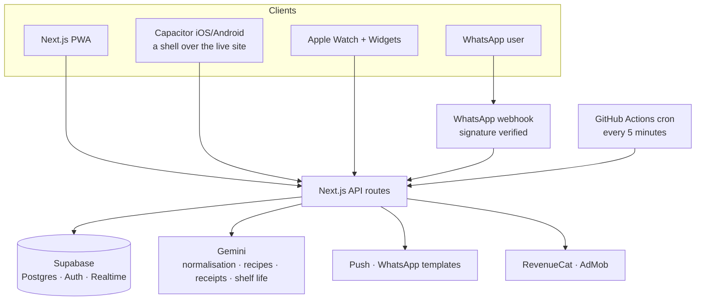
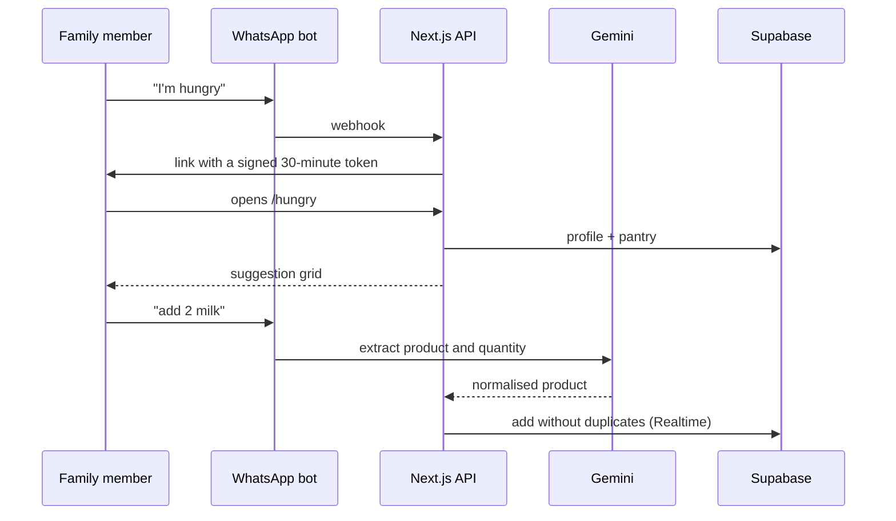

# imhungry — what can I eat right now?

**🟢 Live: [imhungry.appnest.fyi](https://imhungry.appnest.fyi) · iOS and Android apps (including Apple Watch and widgets)**

> An Israeli kitchen app that saves money by cutting food waste — "what can I eat right now from what's already at home?"

Design screenshots (Hebrew UI) with a sample family.

| | |
|---|---|
| **Started** | March 2026 |
| **Scale** | ~1,100 commits · ~880 PRs · 331 test files |
| **Platforms** | Web/PWA, iOS, Android, Apple Watch, widgets, WhatsApp |

## The problem
Families throw food away because they forget what's in the fridge, buy duplicates, and every morning ask again "what do I put in the kids' lunchbox?". Recipe and meal-planning apps take too much effort.

## What the app does
- **"What to eat now?"** — suggestions based on what's at home, who's eating (a profile per family member) and what's urgent, with filters (quick, ready, for kids) and a free-text request ("tell me what you feel like").
- **"10 o'clock meal"** — lunchbox ideas that need no fridge.
- **Recipes from the pantry**, generated by AI, with quantities.
- **"Race against time"** — what's about to spoil, "used it" / "threw it away" in one tap, and shelf-life estimates.
- **"This month's savings"** — how much money was saved by cooking food before it spoiled, and a streak of days without waste.
- **A shared shopping list** in real time, by category, with a **"supermarket mode"**, an AI-generated list, automatic replenishment of items that run out, and history.
- **Receipt scanning** → products go into the pantry automatically (OCR + name mapping).
- **Weekly planning** and a suggested weekly cart.
- **WhatsApp:** "I'm hungry", "we're out of milk", "add 2 milk" — straight from the chat, with proactive reminders via approved templates.
- **Apple Watch and home-screen widgets.**
- Gamification, coupons, family invites, a subscription (RevenueCat) and ads (AdMob).

## Architecture

### From WhatsApp to the web

## Technologies
Next.js 16 · React 19 · TypeScript strict · Tailwind v4 + shadcn/ui · Supabase (Postgres, Auth, Realtime) · Google Gemini · Meta WhatsApp Cloud API · Capacitor 8 · SwiftUI (Watch, widgets) · RevenueCat · AdMob · Firebase (push) · Sentry · Serwist (PWA) · Vitest · Playwright · Vercel · GitHub Actions

## Deployment
- **The website is the app:** the native shell loads the live site, so every Vercel deploy reaches the app on its next launch. A new store build is needed only when something native changes.
- An iOS release script bumps the version across all targets together (app, watch, widgets).
- `pnpm ship`: local checks → wait for the Vercel deploy → merge → prune old deployments.
- Dedicated coding agents in the repo: feature implementer, bug fixer (failing test first), code reviewer and release captain.

## Decisions worth discussing
- **AI only where a mistake isn't dangerous:** allergens and safety use fixed rules, not a model.
- **Product-name normalisation in one place:** the same bug ("is this the same product?") came back five times, until every comparison went through one normaliser with an eval over every receipt line.
- **Idempotent cron:** after an incident of duplicate messages, every scheduled send is keyed by a time window.
- **Hebrew and English on the watch and widgets too** — by the household's language, not the device's.
