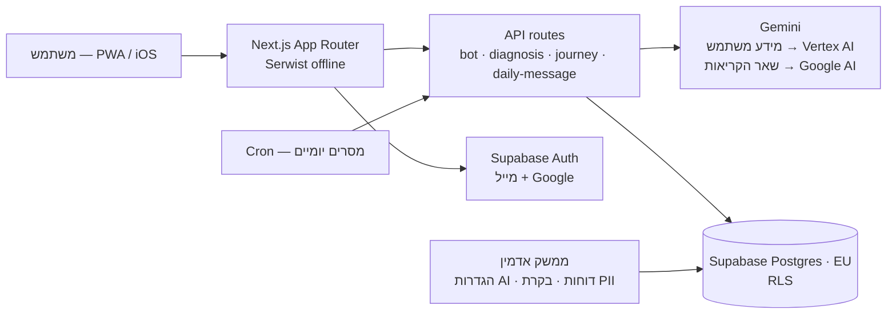

# לצמוח מבפנים · Growing From Within

**🟡 בפיתוח מתקדם · [meital-ai.vercel.app](https://meital-ai.vercel.app) · PWA + iOS**

> ליווי אישי לאנשים בצומת מקצועית — מחפשי עבודה, מי ששוקלים שינוי קריירה ומי שחוזרים לשוק — מבוסס על שיטת אימון בשבעה שלבים.

<!-- MEDIA: מסך אבחון → דוח אישי → שיחה עם הבוט → מסך נטוורקינג -->

| | |
|---|---|
| **התחלה** | פברואר 2026 |
| **היקף** | ~520 קומיטים · ~375 PRs · 33 קבצי בדיקות + 23 בדיקות "guard" |
| **מקור הידע** | שנים של ייעוץ ארגוני, HR ואימון קריירה |

## מה המשתמש מקבל
- **אבחון ודוח אישי:** שאלון (גרסה נפרדת למי שלא עובד כרגע) שמייצר דוח עם ציונים, חוזקות ו"ארכיטיפ", עם גרסאות ומעקב התקדמות.
- **מסלול 7 השלבים:** תרגולים יומיים — רפלקציה, קריאה מונחית ומיני-שיחה — לפי השלב שבו המשתמש נמצא.
- **בוט מלווה בחמישה הקשרים:** אבחון ודוח, מסלול השלבים, פרופיל מקצועי, מועמדות למשרה, ונושא חופשי. בכל הקשר הוא משתמש במידע הרלוונטי על המשתמש.
- **התאמת קורות חיים למשרה:** העלאת קו"ח ומודעת דרושים, וקבלת גרסה מותאמת לפי שיטה מוגדרת.
- **נטוורקינג:** המערכת מזהה עם מי כדאי להתחבר לפי המשרות שסומנו, הדוח והחוזקות — ומציעה **טיוטת פתיחה אישית**.
- **מעקב מועמדויות:** משרה, איש קשר, מגייס, שלב.
- **תרגול ראיון עבודה** (כולל מיקרופון) ו"מוכנות לראיון".
- **מסר יומי** בקול מוגדר, התראות push, גיימיפיקציה ולוח התקדמות.
- **פידבק על תשובות הבוט** (👍/👎) שנשמר לשיפור.

## ארכיטקטורה

## טכנולוגיות
Next.js 16 · React 19 · TypeScript · Tailwind 4 · Supabase (Postgres EU, Auth, RLS) · Google Gemini (Vertex AI למידע אישי) · Capacitor (iOS) · Serwist (PWA offline) · Web Push · Playwright E2E · Vercel

## איכות ותפעול
- **23 בדיקות guard**, 18 מהן לפני כל build — כולל זמינות מודלי AI, חשיפה ציבורית של נתונים ובידוד משתמשי בדיקה מהסטטיסטיקות.
- **כלל: מאמתים guard חדש על ידי החזרת הבאג שהוא אמור לתפוס.**
- **"Thinking" כבוי במודל בכל קריאה** — אחרי שהתגלה שהוא אוכל את תקציב הפלט ויוצר דוחות קטועים.
- בקרת PII בממשק האדמין, הצפנת שדות רגישים ותיקון RLS מתועד.

## חיבור לעולם המקצועי
המוצר מתרגם שיטת אימון אמיתית למוצר דיגיטלי — AI כאן מרחיב את הליווי האישי, לא מחליף אותו.
