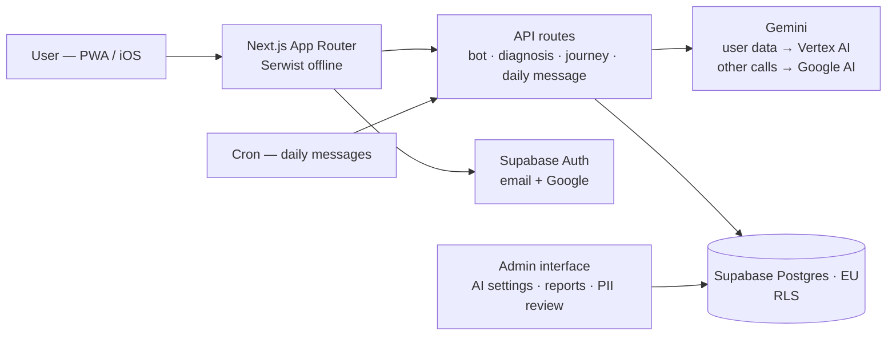

# Growing From Within — career coaching at a professional crossroads

**🟡 Advanced development · [meital-ai.vercel.app](https://meital-ai.vercel.app) · PWA + iOS**

> Personal guidance for people at a professional crossroads — job seekers, people considering a career change and people returning to work — based on a seven-stage coaching method.

<!-- MEDIA: assessment → personal report → bot conversation → networking screen -->

| | |
|---|---|
| **Started** | February 2026 |
| **Scale** | ~520 commits · ~375 PRs · 33 test files + 23 "guard" checks |
| **Domain knowledge** | Years of organisational consulting, HR and career coaching |

## What the user gets
- **Assessment and personal report:** a questionnaire (with a separate version for people not currently working) that produces a report with scores, strengths and an "archetype", with versions and progress tracking.
- **The 7-stage journey:** daily exercises — reflection, guided reading and a mini-conversation — according to the user's stage.
- **A companion bot with five contexts:** assessment and report, the stage journey, professional profile, job applications, and an open topic. In each context it uses the relevant information about the user.
- **CV tailoring:** upload a CV and a job ad, and get a version tailored to it using a defined method.
- **Networking:** the system identifies who is worth connecting with, based on the jobs marked, the report and the strengths — and suggests **a personal opening message draft**.
- **Application tracking:** job, contact, recruiter, stage.
- **Interview practice** (including the microphone) and "interview readiness".
- **A daily message** in a defined voice, push notifications, gamification and a progress board.
- **Feedback on bot answers** (👍/👎), stored for improvement.

## Architecture

## Technologies
Next.js 16 · React 19 · TypeScript · Tailwind 4 · Supabase (Postgres in the EU, Auth, RLS) · Google Gemini (Vertex AI for personal data) · Capacitor (iOS) · Serwist (offline PWA) · Web Push · Playwright end-to-end tests · Vercel

## Quality and operations
- **23 guard checks**, 18 of them before every build — including AI-model availability, public data exposure and keeping test users out of the statistics.
- **Rule: a new guard is verified by reintroducing the bug it is meant to catch.**
- **Model "thinking" is turned off on every call** — after it turned out to eat the output budget and produce truncated reports.
- PII review in the admin interface, encryption of sensitive fields and a documented RLS fix.

## Connection to my professional world
The product turns a real coaching method into a digital product — AI here extends personal guidance rather than replacing it.
