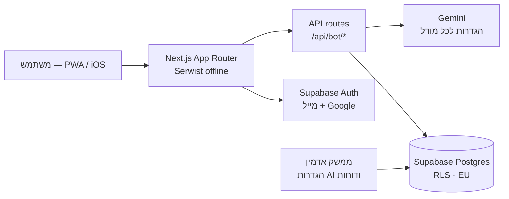

# לצמוח מבפנים · Growing From Within

**🟡 בפיתוח מתקדם · PWA + iOS**

אפליקציה לליווי אנשים בצומת מקצועית — מחפשי עבודה, מי ששוקלים שינוי קריירה, ומי שחוזרים לשוק. מבוססת על שיטת אימון בשבעה שלבים, עם בוט מלווה ודוחות אישיים.

<!-- MEDIA: מסך אבחון → דוח אישי → שיחה עם הבוט -->

## מה המשתמש מקבל
- **אבחון ודוח אישי** — שאלון שמייצר דוח עם גרסאות ומעקב התקדמות.
- **מסלול 7 השלבים** — תוכן ותרגול לפי השלב שבו המשתמש נמצא.
- **בוט מלווה בחמישה הקשרים:** אבחון ודוח, מסלול השלבים, פרופיל מקצועי, מועמדות למשרה, ונושא חופשי. בכל הקשר הבוט משתמש במידע הרלוונטי על המשתמש.
- **התאמת קורות חיים למשרה** — העלאת קו"ח ומודעת דרושים, וקבלת גרסה מותאמת.
- **מסר יומי** בקול שהוגדר מראש, ומעקב מועמדויות.
- **פידבק על תשובות הבוט** (👍/👎) שנשמר לשיפור.

## ארכיטקטורה

## טכנולוגיות
Next.js · TypeScript · Tailwind · Supabase (Postgres EU, Auth, RLS) · Google Gemini · Capacitor (iOS) · Serwist (PWA offline) · Playwright E2E · Vercel

## איכות ותפעול
- **23 בדיקות אוטומטיות לפני כל build**, כולל בדיקה שמודלי ה-AI עדיין זמינים ובדיקה שאין חשיפה ציבורית של נתונים.
- תהליך תיקון אבטחה ל-Supabase (RLS) מתועד ומאומת.
- מחולל משתמשי בדיקה ו-checklist ל-E2E של הבוט.

## חיבור לעולם המקצועי שלי
המוצר מבוסס על ניסיון של שנים בייעוץ ארגוני, HR ואימון קריירה — AI כאן מרחיב את הליווי האישי, לא מחליף אותו.
