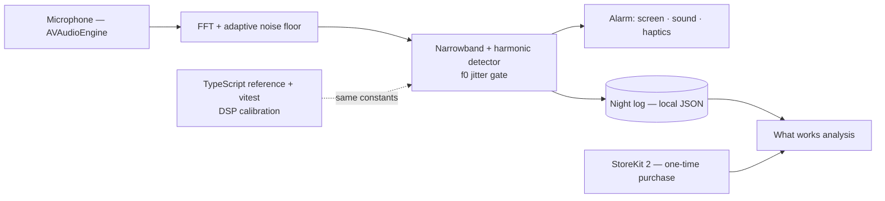

# Mosquito Radar — the honest mosquito app

**🟡 TestFlight · before App Store submission**

A native iOS app that does exactly what a phone can genuinely do about mosquitoes — and tells the truth about the rest. No "ultrasonic repellent" and no "luring flashlight".

<!-- MEDIA: Night Watch screen + the crimson alarm (simulator) -->

| | |
|---|---|
| **Platform** | Native iOS (SwiftUI) |
| **Languages** | 7: English, Spanish, Portuguese, French, Hebrew, Hindi, Indonesian |
| **Network** | Zero network requests — everything stays on the device |
| **Status** | Build on TestFlight, paid-apps agreement signed, App Store pack ready |

## What's in the app
- **Night Watch** — the phone lies by your pillow and listens. When a **female** mosquito's wingbeat (≈350–600 Hz, with the jitter only a live insect has) enters the microphone's ~10 cm range — a full-screen alarm, sound and haptics. It works with the screen locked all night and honestly reports coverage gaps.
- **Hunt Assist** — camera zoom and torch to inspect suspicious dots on the wall.
- **Protection Plan** — a pre-sleep checklist of measures with real evidence, and a morning bite question → an analysis of "what works in your room".
- **What's That Buzz?** — point the phone at a whine and get an honest verdict: machine / could be a mosquito / not a biter.
- **Know Your Enemy** — the science: why 10 cm, why light doesn't lure them.

## Architecture

## Technologies
Swift · SwiftUI · AVAudioEngine · DSP (FFT) in a separate Swift package that is also tested on Linux · StoreKit 2 · XCTest · TypeScript + Vitest as a reference implementation · XcodeGen · 7 languages

## Product decisions
- **Total privacy:** zero network requests. Audio is analysed live and never recorded.
- **Honesty as positioning:** a feasibility study showed that "ultrasonic repellent" apps are documented fraud (a Cochrane review, FTC fines) — so that is exactly what this app doesn't do.
- **A fair business model:** 3 full nights free, then a one-time purchase. Detection and the alarm are never locked.

## Where AI is used
A coding agent built the app and the DSP engine, and calibrated it empirically through a TypeScript reference implementation with tests — so the algorithm can be tested without a device.
