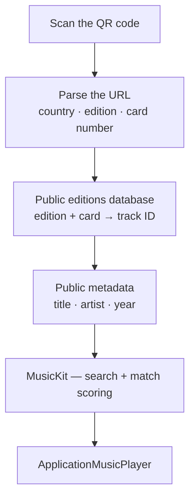

# HitDeck — a card scanner for a music guessing game

**🟢 On the App Store · [Download](https://apps.apple.com/app/id6801653040) · [Landing page](https://danidliod.github.io/shnaton-support/)**

An iOS app that scans the QR code on the cards of a song-guessing party game (including the Israeli edition) and plays the song through Apple Music — instead of requiring Spotify Premium.

<!-- MEDIA: GIF — scan a card → the song plays -->

| | |
|---|---|
| **Platform** | iOS (SwiftUI) |
| **Started** | August 2026 |
| **Model** | Free + a premium upgrade via StoreKit |

## The problem
The cards carry a link, but the link itself doesn't lead to the song. Resolution only happens inside the official app, which works with Spotify only.

## The solution — a resolution chain

## Technologies
Swift · SwiftUI · AVFoundation (QR scanner) · MusicKit · StoreKit (premium) · XcodeGen

## What's interesting here
- **Research before code:** a "phase 0" that tested and ruled out approaches (the official site's redirects) until it found a chain that works with no authentication at all.
- **Matching songs** between two different catalogues with a scoring function.
- **A trademark-clean launch:** the game's brand name doesn't appear in the app name, keywords or store title — only a statement of compatibility.
- **A launch kit** for board-game communities, with full disclosure that I'm the developer.
