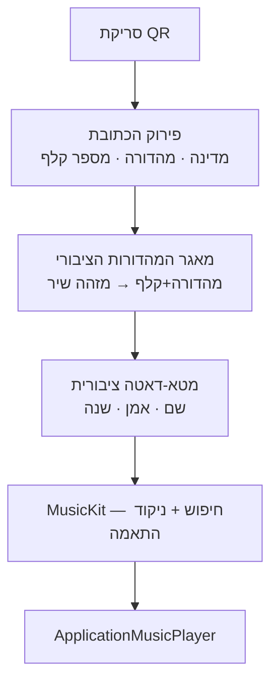

# HitDeck · סורק קלפים למשחק מוזיקה

**🟢 ב-App Store · [להורדה](https://apps.apple.com/app/id6801653040) · [דף נחיתה](https://danidliod.github.io/shnaton-support/)**

אפליקציית iOS שסורקת את קוד ה-QR על קלפי משחק ניחוש שירים (כולל המהדורה הישראלית) ומנגנת את השיר דרך Apple Music — במקום לדרוש Spotify Premium.

<!-- MEDIA: GIF — סריקת קלף → השיר מתנגן -->

## הבעיה
הקלפים מכילים קישור, אבל הקישור עצמו לא מוביל לשיר. הפענוח קורה רק בתוך האפליקציה הרשמית, שעובדת עם Spotify בלבד.

## הפתרון — שרשרת פענוח

## טכנולוגיות
Swift · SwiftUI · AVFoundation (סורק QR) · MusicKit · StoreKit (פרימיום) · XcodeGen

## מה מעניין כאן
- **מחקר לפני קוד:** "שלב 0" שבדק ופסל דרכים (הפניות של האתר הרשמי) עד שנמצאה שרשרת שעובדת בלי שום אימות.
- **התאמת שירים** בין שני קטלוגים שונים עם פונקציית ניקוד.
- **השקה נקייה מבחינת סימן מסחרי:** השם המסחרי של המשחק לא מופיע בשם האפליקציה, במילות המפתח או בכותרת — רק תיאור תאימות.
- **ערכת השקה** לקהילות משחקי קופסה, בגילוי נאות שאני המפתח/ת.
